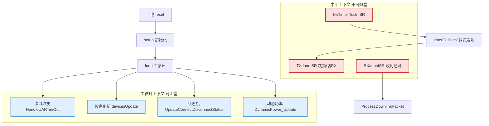

# ExpressLRS 源码详解 00：总览与双链路架构

> 涉及文件：
> - `src/platformio.ini`（构建入口与 env 定义）
> - `src/targets/common.ini`（公共编译选项、射频芯片选择）
> - `src/src/tx_main.cpp`（发射端主逻辑，1920 行）
> - `src/src/rx_main.cpp`（接收端主逻辑，2635 行）
> - `src/src/common.cpp`（速率表与全局状态，434 行）
> - `src/include/common.h`（协议常量与核心结构，448 行）
> - `src/include/targets.h`（编译期总闸门）
> - `src/include/hardware.h`（运行时硬件描述符）
> - `src/lib/OTA/OTA.h`（空口包结构）
> - `src/lib/FHSS/FHSS.cpp`（跳频序列生成）

---

## 1. 这套系统到底在做什么

ExpressLRS（下称 ELRS）是一套**双向无线遥控链路**：地面端的 TX 模块插在遥控器上，
空中的 RX 接收机用一根串口线（或若干路 PWM）连飞控/舵机。它的目标不是“传得多”，
而是**传得准、传得快、传得远**——一帧遥控数据只有 8 或 13 字节，却要做到
1000Hz 刷新、几十公里距离、丢包可恢复。

三个数字先建立直觉：

| 指标 | 典型值 | 来源 |
|---|---|---|
| 空口包长 | 8 B（OTA4）/ 13 B（OTA8） | `OTA.h` 的 `OTA4_PACKET_SIZE`/`OTA8_PACKET_SIZE` |
| 最快包率 | 1000 Hz（FLRC 2.4G） | `common.cpp` 中 `RATE_FLRC_2G4_1000HZ` 档 `interval=1000us` |
| 单包空中时间 | 389 us（FLRC 1000Hz） | 同表 `TOA` 字段 |
| 最慢包率 | 25 Hz（LoRa 900M） | 同表 `RATE_LORA_900_25HZ` 档 `interval=40000us` |
| 最远档灵敏度 | -123 dBm | 900M 25Hz 档 `RXsensitivity` |

也就是说：最快档每 1ms 发一包、每包只占 0.389ms 空口；最远档每 40ms 发一包，
但接收灵敏度比最快档好 19dB（约 79 倍功率比）。

---

## 2. 两种角色：TX 与 RX

TX 与 RX 共享 `common.cpp`/`common.h`/`OTA`/`FHSS`/`CRSF` 这些模块，但主程序完全分离，
由 `TARGET_TX` / `TARGET_RX` 两个编译宏裁剪。对照表：

| 维度 | TX（发射端） | RX（接收端） |
|---|---|---|
| 入口文件 | `src/src/tx_main.cpp` | `src/src/rx_main.cpp` |
| 上游 | 遥控器（CRSF 串口 / USB / 蓝牙 / 背包） | 空口（SX127x/SX1280/LR1121/LR2021） |
| 下游 | 空口 | 飞控（CRSF/SBUS/SUMD/MAVLink…）或 PWM 焊盘 |
| 定时器角色 | Tock 到点就**发**一包 | Tock 到点**跳频 + 可能发遥测** |
| 状态机 | `noCrossfire → awaitingModelId → disconnected → connected` | `disconnected → tentative → connected` |
| 遥测方向 | 收（downlink） | 发（uplink telemetry） |
| 独有硬件 | 屏幕、五向键、背包、风扇、BLE | PWM 输出、电压/气压计、VTX 控制 |
| 典型循环负担 | 组包 + SPI 写 | 解包 + 相位校准 + PWM 刷新 |

注意状态命名是**从各自视角**定义的：“uplink” 永远指 TX→RX（遥控指令），
“downlink” 永远指 RX→TX（遥测）。读代码时若把 `uplink_RSSI` 当成“RX 收到的信号”
就会绕晕——它其实是“TX 发射的信号在 RX 处的强度”。

---

## 3. LoRa 与 FLRC：两种调制，两套取舍

ELRS 的“模式”本质是**调制方式 + 带宽 + 扩频因子**的组合。2.4G 芯片 SX1280 同时支持
LoRa 与 FLRC；900M 的 SX127x 只有 LoRa（以及一个实验性的 FSK 1000Hz 档）。

| 特性 | LoRa | FLRC |
|---|---|---|
| 扩频 | 有（SF5~SF12），符号率低 | 无（固定 0.65/1.3 Mbps 码率） |
| 抗干扰 | 强（处理增益 = SF×3dB 量级） | 弱，但靠 CRC+FEC 兜底 |
| 灵敏度 | -104 ~ -123 dBm | -104 dBm 左右 |
| 最短 TOA | 1507us（SF5/800K/500Hz） | 389us（1000Hz） |
| 典型用途 | 远距、穿障、城市 | 竞速、近距离、低延迟 |
| 参数来源 | `SX1280_LORA_SF*` / `SX1280_LORA_BW_0800` | `SX1280_FLRC_BR_0_650_BW_0_6` |

`common.cpp` 的 SX1280 表里前 4 档是 FLRC、后 6 档是 LoRa；900M 表全是 LoRa。
选择逻辑不在代码里硬编码，而是“用户配置档位 → `SetRFLinkRate()` 把该行的
BW/SF/CR/PreambleLen 原样喂给 `Radio.Config()`”。所以**加一档新速率 = 加一行表项**，
不需要改任何流程代码。

---

## 4. 硬件生态：一份固件，几百块板子

`src/targets/` 下只有 9 个 `.ini`，它们不是“每块板一个文件”，而是**按 MCU 平台**
（esp32 / esp32s3 / esp32c3 / esp8285 × tx/rx）分组。真正的板级差异在运行时：

| 层次 | 载体 | 例子 |
|---|---|---|
| 编译期平台 | `targets/esp32-tx.ini` | `PLATFORM_ESP32`、`TARGET_TX` |
| 编译期射频 | `targets/common.ini` 的 `radio_SX128X` | `RADIO_SX128X=1` |
| 编译期监管域 | `user_defines.txt` / `-D` | `Regulatory_Domain_FCC_915` |
| 运行时引脚 | `hardware.json` + `hardware.h` 枚举 | `HARDWARE_radio_nss` |
| 运行时功能 | `options.json` | 是否启用背包、屏幕型号 |

`include/hardware.h` 里那个 180 多个枚举值的 `nameType` 就是这套机制的“字典”：
`hardware_pin(HARDWARE_radio_nss)` 之类的调用把 JSON 里的键翻译成引脚号。
好处是**同一份固件可以 OTA 刷到不同板子上**，只换 JSON；代价是每次读引脚都要查表，
所以热点路径（ISR）里都提前把引脚存进常量或直接内联。

---

## 5. 一次遥控指令的完整旅程（数据流）

下面这张图是全工程的“主数据通路”。注意它同时画了两条方向相反的链路：
上半部分是遥控指令（TX→RX），下半部分是遥测（RX→TX）。

数据载体在各阶段的形态：

| 阶段 | 载体 | 大小 | 所在文件 |
|---|---|---|---|
| 遥控器输出 | CRSF 帧 | 最大 64 B | `crsf_protocol.h` |
| 内部通道 | `uint32_t ChannelData[16]` | 64 B | `common.cpp` |
| 空口 OTA4 | `OTA_Packet4_s` | 8 B | `OTA.h` |
| 空口 OTA8 | `OTA_Packet8_s` | 13 B | `OTA.h` |
| 下行分片 | `DataDlBuffer` | 64 B | `rx_main.cpp` |
| 上行分片 | `DataUlBuffer` | 65 B | `rx_main.cpp` |

---

## 6. 执行流：谁在什么时候跑

ELRS 没有 RTOS 任务，全部是“**一个主循环 + 两个定时器中断 + 两个射频中断**”。
这五条执行流的关系必须记住，否则读 `volatile`/临界区代码会毫无头绪。

关键约束：

1. **ISR 里不能调用会阻塞的函数**（EEPROM 写、`delay`、WiFi）。所以配置落盘走
   `CheckConfigChangePending()` → 先停发射 → 再 `config.Commit()`。
2. **ISR 与主循环共享的变量必须 `volatile` 或只由一方写**。典型例子：
   `syncSpamCounter`（两边读写，volatile）、`busyTransmitting`（ISR 写、loop 读）。
3. **主循环可以被 ISR 随时打断**，因此 loop 里读多字节共享变量时要先拷到局部
   （`rx_main.cpp` 的 `localLastValidPacket` 就是为此）。

---

## 7. 为什么“发一包”要绕这么多层

初学者最容易问的问题：为什么不能直接把 16 个通道塞进 LoRa 的 FIFO 发出去？
因为 ELRS 要在 8 字节里同时塞下：

- 类型（2 bit，RC/SYNC/DATA 三选一）
- 4 个通道 × 10 bit（`OTA_Channels_4x10`，5 字节）
- 7 个开关位 + 1 个武装位
- 14 bit CRC（借用类型位之外的 6 bit 高字节）

合计正好 8 字节。这套“位域拼图”就是 `OTA.cpp` 里 `PackUInt11ToChannels4x10()`
和 `GenerateChannelData*()` 系列函数存在的理由。13 字节的 OTA8 则放宽到
8 或 12 个通道 + 16bit CRC，用于高分辨率档位。

---

## 8. 目录地图（只列需要读的）

| 路径 | 作用 | 本次是否注释 |
|---|---|---|
| `src/src/tx_main.cpp` | TX 主逻辑 | A 级逐函数 |
| `src/src/rx_main.cpp` | RX 主逻辑 | A 级逐函数 |
| `src/src/common.cpp` | 速率表 / 全局状态 | A 级逐函数 |
| `src/include/common.h` | 协议常量 / 结构 | A 级逐函数 |
| `src/src/dynpower.cpp` | 动态功率 | B 级文件头 |
| `src/src/rxtx_common.cpp` | 延迟执行 / I2C / 重启 | B 级文件头 |
| `src/include/crsf_protocol.h` | CRSF 帧格式 | B 级文件头 |
| `src/include/targets.h` / `hardware.h` | 编译期/运行时硬件抽象 | B 级文件头 |
| `src/lib/OTA/` | 空口打包 | 只读不注释 |
| `src/lib/FHSS/` | 跳频序列 | 只读不注释 |
| `src/lib/SX1280Driver/` | 射频驱动 | 只读不注释 |
| `src/targets/*.ini` | 平台编译配置 | 不动 |

---

## 9. 读码路径建议

按“一条数据走完全程”的顺序读，比按文件顺序读有效得多：

1. `tx_main.cpp` 的 `setup()` → `loop()`，先建立“什么时候会发射”的直觉；
2. `timerCallback()` → `SendRCdataToRF()`，看一包怎么被组出来；
3. `OTA.h` 的 `OTA_Packet4_s` 与 `OTA.cpp` 的打包函数，看位怎么排；
4. `rx_main.cpp` 的 `ProcessRFPacket()`，看同样的位怎么被拆开；
5. `HWtimerCallbackTock()`，看跳频与遥测窗口如何共用一条时间轴；
6. 回到 `common.cpp` 的两张表，理解“为什么这个档位是这个参数”。

---

## 10. 陷阱与实测建议

| 现象 | 常见根因 | 排查入口 |
|---|---|---|
| TX 上电一直 `noCrossfire` | 遥控器波特率不匹配 / 串口引脚错 | `UARTconnected()` 是否被调用 |
| 能连上但遥测全丢 | `PACKET_TO_TOCK_SLACK` 与 TOA 不匹配 | `ProcessRFPacket()` 里的 `slack` 计算 |
| 距离一远就断，回近也不恢复 | RX 卡在某个不支持档位 | `isSupportedRFRate()` / `cycleRfMode()` |
| 换速率后要等很久才连上 | sync spam 次数不够 | `syncSpamAmountAfterRateChange=10` |
| 两台设备互相干扰 | UID 相同（都用 MAC 且 MAC 相邻） | `setupBindingFromConfig()` |

实测建议：先把 TX 固定在 50Hz、TLM 1:16，用 Web UI 看 LQ 随距离的变化曲线；
再逐档升速，观察同一位置的 LQ 掉多少——这比任何理论推导都更能建立“速率-距离”
的量化直觉。
