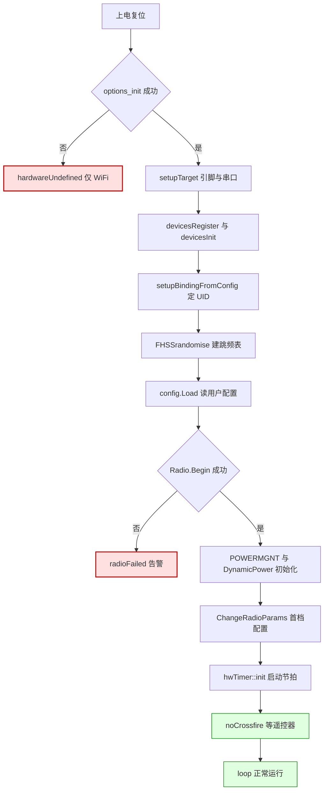
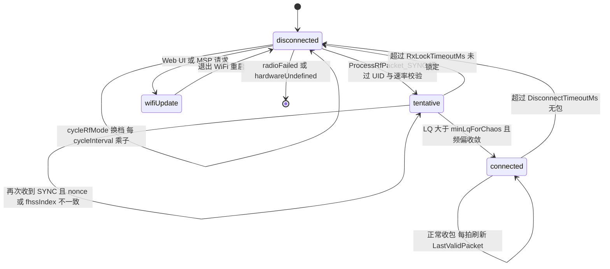
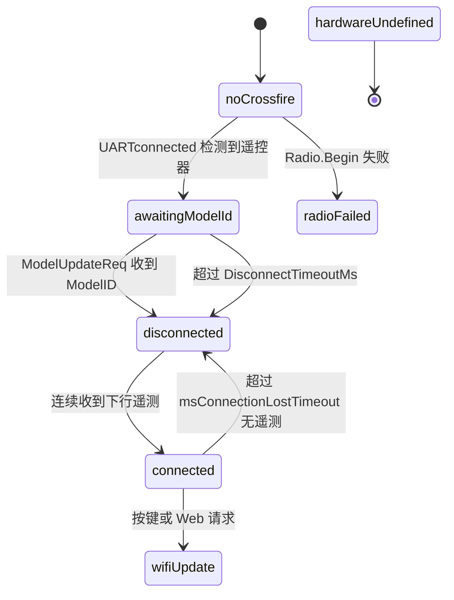
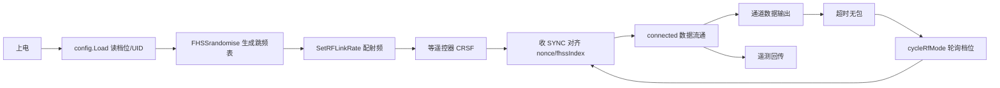

# ExpressLRS 源码详解 01：启动流程与状态机

> 涉及文件：
> - `src/src/tx_main.cpp`（`setup()` 1726 行、`loop()` 1830 行、`timerCallback()` 814 行）
> - `src/src/rx_main.cpp`（`setup()` 1726 行、`loop()` 1830 行、`updateBindingMode()` 2102 行）
> - `src/src/common.cpp`（`setConnectionState` 实现在 `common.h` 429 行）
> - `src/include/common.h`（`connectionState_e` 65 行）
> - `src/src/rxtx_common.cpp`（`deferExecutionMicros()` 93 行）
> - `src/lib/CONFIG/config.h`（配置读写接口）

---

## 1. 状态集合：一个枚举，三类哨兵

`common.h` 第 65 行定义的 `connectionState_e` 是整机唯一的“运行状态”来源。
它不是一个普通枚举，而是**用哨兵值切分成四段**，代码靠大小比较做区间判断：

```c
typedef enum
{
    connected,        // 已收到有效下行包，链路可用
    tentative,        // RX only：刚收到 SYNC，时钟/频率尚未锁定
    awaitingModelId,  // TX only：等遥控器发来 ModelID 再开始发射
    disconnected,     // 有 CRSF 但射频侧失联（仍在跳频搜索）
    MODE_STATES,
    // States below here are special mode states
    noCrossfire,      // TX：没检测到遥控器串口
    bleJoystick,      // TX：BLE 手柄模式，无射频
    NO_CONFIG_SAVE_STATES,
    wifiUpdate,       // 进入 WiFi 升级/配置，停止射频
    serialUpdate,     // 串口 passthrough 刷机
    // Failure states go below here to display immediately
    FAILURE_STATES,
    radioFailed,      // 无线芯片初始化失败
    hardwareUndefined // options.json 缺失/非法
} connectionState_e;
```

| 区间 | 取值范围 | 语义 | 典型判断代码 |
|---|---|---|---|
| 正常链路态 | `< MODE_STATES` | 可以发射/接收 | `if (connectionState < MODE_STATES)` |
| 特殊模式态 | `>= MODE_STATES` 且 `< NO_CONFIG_SAVE_STATES` | 停射频/换用途 | `if (connectionState > MODE_STATES) return;` |
| 禁写配置态 | `>= NO_CONFIG_SAVE_STATES` 且 `< FAILURE_STATES` | 不许写 EEPROM | `connectionState < NO_CONFIG_SAVE_STATES` |
| 故障态 | `>= FAILURE_STATES` | 立即上报告警 | LED 设备直接红灯 |

**设计意图**：新增状态时只要插进正确区间，所有已有的区间判断自动生效，
不需要去每个 `if` 里补一条。这是嵌入式里用“哨兵枚举”替代状态位图的经典手法。

**陷阱**：`connected` 的值是 0，所以 `if (connectionState)` 这种写法是错的
（会把 connected 当 false）。代码里一律显式比较。

---

## 2. TX 启动流程：十步，顺序不能换

`tx_main.cpp` 的 `setup()`（1726 行）按下面的顺序执行。每一步都有“为什么必须在这里”的理由：

| 步 | 调用 | 行号 | 为什么必须在此位置 |
|---|---|---|---|
| 1 | `setupHardwareFromOptions()` | 1615 | 读 options.json，后面所有引脚宏才有值 |
| 2 | `setupTarget()` | 1589 | 释放 UART0、配置天线脚、建串口 |
| 3 | `devicesRegister/Init()` | 1729-1731 | 设备要在配置加载前注册，才能响应后续事件 |
| 4 | `setupBindingFromConfig()` | 1638 | 决定 UID，后续 FHSS/CRC 都依赖它 |
| 5 | `FHSSrandomiseFHSSsequence()` | 1738 | `Radio.Config()` 要读 `FHSSgetInitialFreq()` |
| 6 | 注册 `RXdoneCallback/TXdoneCallback` | 1740-1741 | 中断可能在 `Begin()` 里就触发 |
| 7 | `crsfTransmitter.begin()` 等 | 1743-1752 | 建立 CRSF 路由（AirPort 模式跳过） |
| 8 | `config.Load()` | 1754 | 要在 `ChangeRadioParams()` 之前拿到用户档位 |
| 9 | `Radio.currFreq = ...` + `Radio.Begin()` | 1756-1792 | 频率必须先赋值，否则 Begin 内校验失败 |
| 10 | `POWERMGNT::init()` → `ChangeRadioParams()` → `hwTimer::init()` | 1798-1806 | 功率先于速率；定时器最后启动 |

第 9 步的注释很直白：

```c
    Radio.currFreq = FHSSgetInitialFreq(); //set frequency first or an error will occur!!!
```

这不是夸张——SX1280 驱动的 `Begin()` 会用 `currFreq` 做一次“频率是否在合法范围”
的断言，未初始化时是 0，直接判定芯片异常。

第 6 步容易被忽略：`Radio.Begin()` 内部会做一次自检收发，可能触发中断回调，
所以回调必须先挂好，否则会跳到空指针。

下面这张图把十步串成执行流，标出三条“失败即终止”的分支：



---

## 3. RX 启动流程：先读配置，再定串口

RX 的顺序与 TX 明显不同（`rx_main.cpp` 的 `setup()`，1726 行）：

| 步 | 调用 | 行号 | 与 TX 的差异 |
|---|---|---|---|
| 1 | `options_init()` | 2378 | 同样最先 |
| 2 | `setupConfigAndPocCheck()` | 2415 | **先读 EEPROM**，因为串口协议存在配置里 |
| 3 | `setupTarget()` | 1589 | 天线脚 + I2C |
| 4 | 扫描 PWM 表找 `somSerial` | 2419-2430 | 纯 PWM 板可能没有固定串口脚 |
| 5 | `setupSerial()` / `setupSerial1()` | 2433-2434 | 按配置选 CRSF/SBUS/… |
| 6 | `devicesRegister/Init()` | 2436-2437 | 设备在射频前初始化 |
| 7 | `setupBindingFromConfig()` | 1638 | 未绑定则 UID 保持全 0 |
| 8 | `FHSSrandomiseFHSSsequence()` | 2441 | 同 TX |
| 9 | `setupRadio()` | 2443 | 内部完成 `Radio.Begin()` + 首档守听 |
| 10 | `DataUlReceiver.SetDataToReceive()` + `Radio.RXnb()` + `hwTimer::init()` | 2449-2451 | 直接进入守听，没有 awaitingModelId |

差异的根源：**RX 的串口协议是用户可配置的**（可能存在 EEPROM 里），
所以必须先 `config.Load()` 才能决定用哪个 `SerialIO` 子类；而 TX 的串口
只有 CRSF 一种（USB/背包是附加通路），顺序可以往后放。

另一个差异是 RX 没有 `awaitingModelId`：它不需要等谁，上电就该听空中。

---

## 4. RX 状态机（核心）

RX 的状态迁移比 TX 复杂，因为它要处理“搜频 → 半同步 → 锁定 → 掉线 → 再搜”。
下图是完整迁移，标注了触发条件与代码位置：



对应的判定代码集中在 `loop()`（1830 行）里，顺序就是优先级：

```c
    if ((connectionState != disconnected) && (ExpressLRS_currAirRate_Modparams->index != ExpressLRS_nextAirRateIndex)) // forced change
    {
        DBGLN("Req air rate change %u->%u", ...);
        LostConnection(true);
```

```c
    if (connectionState == tentative && (now - LastSyncPacket > ExpressLRS_currAirRate_RFperfParams->RxLockTimeoutMs))
    {
        DBGLN("Bad sync, aborting");
        LostConnection(true);
```

```c
    if ((connectionState == connected) && ((int32_t)ExpressLRS_currAirRate_RFperfParams->DisconnectTimeoutMs < (int32_t)(now - localLastValidPacket))) // check if we lost conn.
    {
        LostConnection(true);
```

```c
    if ((connectionState == tentative) && (abs(LPF_OffsetDx.value()) <= 10) && (LPF_Offset.value() < 100) && (LQCalc.getLQRaw() > minLqForChaos())) //detects when we are connected
    {
        GotConnection(now);
    }
```

四个条件的量化含义：

| 条件 | 阈值 | 单位 | 来源 |
|---|---|---|---|
| `RxLockTimeoutMs` | 2500（2.4G FLRC）/ 4000（900M 25Hz） | ms | `common.cpp` 性能表 |
| `DisconnectTimeoutMs` | 2500 / 6000 | ms | 同上 |
| `LPF_OffsetDx` | ≤10 | 定时器 tick | `LPF_OffsetDx(4)` 滤波后 |
| `LPF_Offset` | <100 | 同上 | `LPF_Offset(2)` 滤波后 |
| `minLqForChaos()` | 4~36 | % | 由 FHSS 频道数算出 |

`GotConnection()` 要求“频偏变化率小 + 绝对频偏小 + LQ 超过干扰下限”三者同时满足，
这是为了防止“被一个固定频点的强干扰源骗成已连接”。

---

## 5. TX 状态机：多一个 awaitingModelId

TX 的状态少，但多了一个“等模型号”的中间态：



`awaitingModelId` 存在的原因写在 `UARTconnected()`（890 行）的注释里：

```c
    // When CRSF first connects, always go into a brief delay before
    // starting to transmit, to make sure a ModelID update isn't coming
    // right behind it
```

遥控器在串口建立后会**紧接着**发一帧 ModelID。如果 TX 立刻开始发射，就会用旧的
modelId 去算 `UID5` 异或，RX 的 ModelMatch 校验失败，表现为“要等几秒才连上”。
所以这里故意停一下，等 `ModelUpdateReq()` 把它踢出该状态。

`timerCallback()`（814 行）里也有一条对应的早退：

```c
  // Do not transmit or advance FHSS/Nonce until in disconnected/connected state
  if (connectionState == awaitingModelId)
    return;
```

注意它**连 nonce 都不推进**——这样恢复发射时 nonce 与 RX 的预期仍然对齐。

---

## 6. 绑定流程：两端必须严格对称

绑定是唯一“绕过正常同步”的流程，两端各有一套 `EnterBindingMode()`。
对称性体现在三个常量上：

| 要素 | TX（1233 行） | RX（2016 行） | 必须一致的原因 |
|---|---|---|---|
| 速率 | `RATE_BINDING`（50Hz） | `RATE_BINDING` | 否则互相听不到 |
| CRC 初值 | `OTA_VERSION_ID` | `OTA_VERSION_ID` | 此时还不知道对方 UID |
| IQ 极性 | `invertIQ = true` | `bindMode=true` 传入 | 绑定用固定反转 IQ 规避同频干扰 |
| nonce | 锁定 0 | 不推进 | 避免 RX 用旧 UID 误同步 |

TX 侧的完整时序：

```c
  hwTimer::stop();
  while (busyTransmitting);

  // Queue up sending the Master UID as MSP packets
  SendUIDOverMSP();

  // Binding uses 50Hz, and InvertIQ
  OtaCrcInitializer = OTA_VERSION_ID;
  OtaNonce = 0; // Lock the OtaNonce to prevent syncspam packets
  InBindingMode = true; // Set binding mode before SetRFLinkRate() for correct IQ

  SetRFLinkRate(enumRatetoIndexSafe(RATE_BINDING));
  hwTimer::resume();
```

`InBindingMode = true` 必须在 `SetRFLinkRate()` 之前，因为后者会读它来决定 IQ。
这个顺序如果写反，现象是“绑定模式能发但 RX 收不到”，极难排查。

RX 侧多一层“什么时候该进绑定”的判定（`updateBindingMode()`，2102 行），
五个分支按优先级排列：

1. 配置被修改（UID 已写入）→ 退出绑定；
2. 双频芯片（LR1121/LR2021）每 125ms 在 900M/2.4G 之间跳，兼容单频 TX；
3. `PowerOnCounter >= 3` → 进入绑定（三插拔）；
4. `!OtaUidIsBound(UID)` → 进入绑定（新机首次上电）；
5. `BindingModeRequest` → 由 OTA/按键触发。

第 3 条就是“三插拔绑定”的实现，配套代码在 `setupConfigAndPocCheck()`（1834 行）：

```c
    if (config.GetIsBound() && config.GetPowerOnCounter() < 3)
    {
        config.SetPowerOnCounter(config.GetPowerOnCounter() + 1);
        config.Commit();
    }
```

每次上电 +1，2 秒内没连上就清零（`deferExecutionMillis(2000, ...)`）。
连续三次“上电—立刻断电”就能把计数堆到 3，下次上电直接进绑定。
这是一个**不需要按键、不需要 WiFi** 的应急通道。

---

## 7. 启动阶段的时间预算

以 2.4G、ESP32、CRSF 遥控器为例，从复位到“可以起飞”大致经历：

| 阶段 | 耗时 | 主要成本 |
|---|---|---|
| Bootloader + Arduino 核心 | 300~600 ms | Flash 启动、外设初始化 |
| `options_init()` 解析 JSON | 5~20 ms | LittleFS 读 + JSON 解析 |
| `config.Load()` | 1~5 ms | EEPROM 读 100 字节量级 |
| `Radio.Begin()` | 10~30 ms | SPI 自检、TCXO 稳定 |
| CRSF 波特率探测 | 0~2000 ms | `handset` 扫描 420k/115200 等 |
| 首次 sync + RX 锁定 | 20~500 ms | 取决于双方档位是否一致 |
| **合计** | **约 0.5~3 s** | 大部分时间花在等遥控器 |

这也是为什么“上电后要等一两秒才有红灯变绿灯”是正常现象。

---

## 8. 数据流视角：状态如何影响数据通路



图中每个箭头都对应一个函数，读代码时可以按箭头找入口：

| 箭头 | 函数 | 文件:行 |
|---|---|---|
| 读配置 | `config.Load()` | `tx_main.cpp:1754` |
| 生成跳频表 | `FHSSrandomiseFHSSsequence()` | `tx_main.cpp:1738` |
| 配射频 | `SetRFLinkRate()` | `tx_main.cpp:547` |
| 对齐 | `ProcessRfPacket_SYNC()` | `rx_main.cpp:1239` |
| 输出 | `crsfRCFrameAvailable()` | `rx_main.cpp:1073` 内调用 |
| 轮询 | `cycleRfMode()` | `rx_main.cpp` 1979 行 |

---

## 9. 故障态：三种“起不来”

| 状态 | 触发条件 | 表现 | 恢复方式 |
|---|---|---|---|
| `radioFailed` | `Radio.Begin()` 返回 false | LED 快闪，无射频 | 检查 SPI 引脚/供电；Web UI 可进 |
| `hardwareUndefined` | `options_init()` 失败 | 只启动 WiFi | 重新刷 options.json |
| `noCrossfire` | 没有 CRSF 输入（TX） | 不发射，等待 | 检查波特率/线序 |

`hardwareUndefined` 的处理很讲究：它**只注册 WiFi 设备**，因为此时射频和串口
都不可信，唯一还能救砖的路径就是 Web UI。

---

## 10. 陷阱与实测建议

1. **改状态必须走 `setConnectionState()`**，不能直接赋值。该函数在 `common.h` 里，
   会顺带 `devicesTriggerEvent(EVENT_CONNECTION_CHANGED)`；直接赋值会让 LED/屏幕
   停在旧状态。
2. **不要在 ISR 里改状态**。所有 `setConnectionState()` 调用都在主循环或初始化里，
   ISR 只改标志位（如 `doStartTimer`），由 loop 决定迁移。
3. **`tentative` 不是“连上了”**。此时通道数据还不往飞控送（`ProcessRfPacket_RC`
   要求 `connectionState == connected`），这是为了防止用半同步的数据驱动舵机。
4. **实测建议**：把 LED 状态与 `connectionState` 对照表打印出来贴在桌上，
   观察上电时 LED 的每一次变化，比看日志更快定位卡在哪个状态。

| LED 表现 | 可能状态 | 下一步 |
|---|---|---|
| 慢闪 | `disconnected` / `noCrossfire` | 看串口是否有 CRSF |
| 双闪 | `tentative` | 看是否收到 SYNC 但频偏不收敛 |
| 常亮 | `connected` | 正常 |
| 快闪 | `radioFailed` | 查硬件 |
