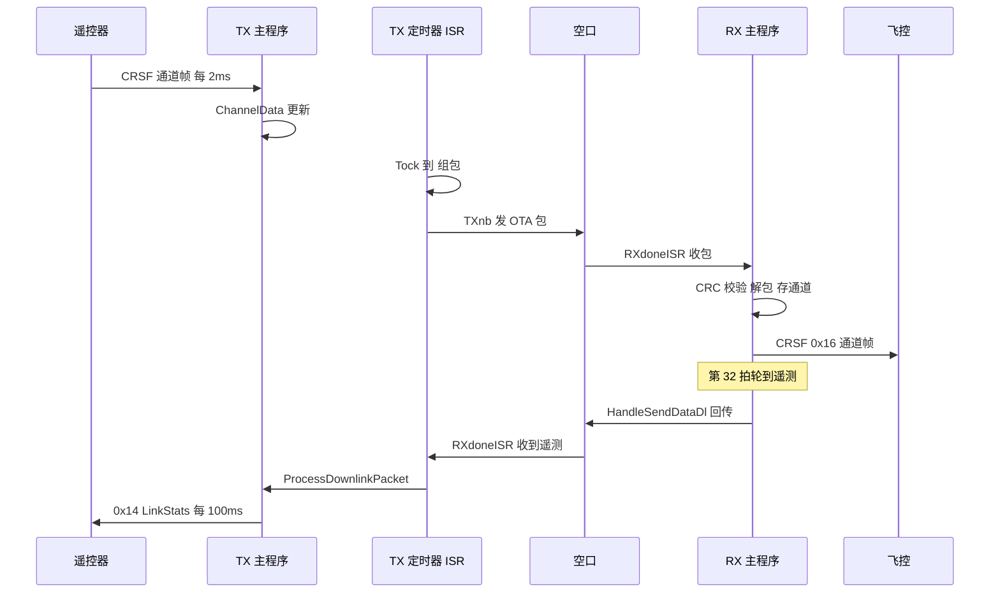
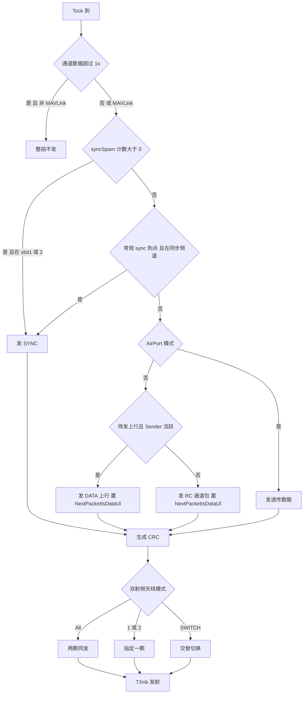
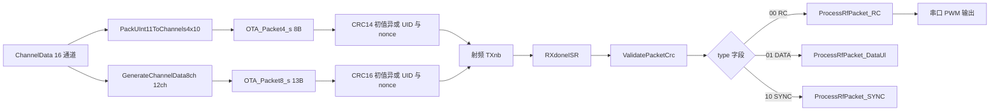

# ExpressLRS 源码详解 02：OTA 空中协议精读

> 涉及文件：
> - `src/lib/OTA/OTA.h`（包结构、类型常量、CRC 多项式）
> - `src/lib/OTA/OTA.cpp`（打包/解包/CRC 实现，636 行）
> - `src/src/tx_main.cpp`（`SendRCdataToRF()` 642 行、`GenerateSyncPacketData()` 474 行）
> - `src/src/rx_main.cpp`（`ProcessRFPacket()` 1335 行、`HandleSendDataDl()` 560 行）
> - `src/src/common.cpp`（速率/性能表，SX1280 表 74~84 行）
> - `src/lib/FHSS/FHSS.cpp`（跳频序列，235 行）
> - `src/include/telemetry_protocol.h`（分片常量）
> - `src/lib/FEC/FEC.h`（Hamming + 交织）

---

## 1. 空口只有两种包长

ELRS 的空口包不是可变长的，只有两个尺寸，用宏写死并在编译期断言：

```c
#define OTA4_PACKET_SIZE     8U
#define OTA4_CRC_CALC_LEN    offsetof(OTA_Packet4_s, crcLow)
#define OTA8_PACKET_SIZE     13U
#define OTA8_CRC_CALC_LEN    offsetof(OTA_Packet8_s, crc)
```

`OTA.cpp` 开头有两条 `static_assert` 保护结构体不被编译器插填充：

```c
static_assert(sizeof(OTA_Packet4_s) == OTA4_PACKET_SIZE, "OTA4 packet struct is invalid!");
static_assert(sizeof(OTA_Packet8_s) == OTA8_PACKET_SIZE, "OTA8 packet struct is invalid!");
```

8 字节包（OTA4）用 CRC14，13 字节包（OTA8，也叫 FullRes）用 CRC16。
包长由速率表里的 `PayloadLength` 字段决定，`OtaUpdateSerializers()` 据此
把四个函数指针（打包/解包/校验/生成 CRC）切到对应实现——这是**用函数指针做
“运行时多态”**，避免每个调用点都写 `if (OtaIsFullRes)`。

| 包型 | 长度 | CRC | 通道数 | 适用档位 |
|---|---|---|---|---|
| OTA4 | 8 B | CRC14（2 字节内嵌） | 4（+开关位） | 绝大多数档位 |
| OTA8 | 13 B | CRC16（2 字节） | 8 或 12 | `*_8CH` 档、FullRes 档 |

---

## 2. OTA4 的位图：8 字节怎么塞下 4 个通道

```c
typedef struct {
    // The packet type must always be the low two bits of the first byte of the
    // packet to match the same placement in OTA_Packet8_s
    uint8_t type: 2,
            crcHigh: 6;
    union {
        /** PACKET_TYPE_RCDATA **/
        struct {
            OTA_Channels_4x10 ch;
            uint8_t switches:7, // includes stubbornAck
                    isArmed:1;
        } rc;
        ...
    };
    uint8_t crcLow;
} PACKED OTA_Packet4_s;
```

逐字段拆解：

| 偏移 | 位宽 | 字段 | 含义 |
|---|---|---|---|
| byte0 bit0-1 | 2 | `type` | 00=RC，01=DATA，10=SYNC，11=保留 |
| byte0 bit2-7 | 6 | `crcHigh` | CRC 的高 6 位（低 8 位在 byte7） |
| byte1-5 | 40 | `ch` | 4 通道 × 10 bit |
| byte6 bit0-6 | 7 | `switches` | 开关档位（含 stubbornAck） |
| byte6 bit7 | 1 | `isArmed` | 武装标志 |
| byte7 | 8 | `crcLow` | CRC 低 8 位 |

关键设计：**类型位放在第一字节最低 2 位**，且 OTA4 与 OTA8 保持同一位置。
这样接收端在还不知道包长的情况下，只要读第一字节就能判断类型——
`ProcessRFPacket()` 里就是先 `switch (otaPktPtr->std.type)`。

`OTA_Channels_4x10` 是 5 字节，装 4 个 10bit 通道（40 bit 正好 5 字节）：

```c
static void ICACHE_RAM_ATTR PackUInt11ToChannels4x10(uint32_t const * const src, OTA_Channels_4x10 * const destChannels4x10, Decimate11to10_fn decimate)
{
    const unsigned DEST_PRECISION = 10; // number of bits for each dest, must be <SRC
    uint8_t *dest = (uint8_t *)destChannels4x10;
    *dest = 0;
    unsigned destShift = 0;
    for (unsigned ch=0; ch<4; ++ch)
    {
        unsigned chVal = decimate(src[ch]);
        *dest++ |= chVal << destShift;
        unsigned srcBitsLeft = DEST_PRECISION - 8 + destShift;
        *dest = chVal >> (DEST_PRECISION - srcBitsLeft);
        destShift = srcBitsLeft;
    }
}
```

**为什么是 10bit 而不是 CRSF 的 11bit**：11bit 装 4 个需要 44bit，超出 40bit 预算。
所以先做一次“降精度”（`Decimate11to10_Limit` 或 `Decimate11to10_Div2`），
把 172..1811 映射到 0..1023。代价是每格约 1.6us 分辨率，对舵机来说完全够用。

---

## 3. SYNC 包：11 字节的“对齐信息”

`OTA_Sync_s` 是所有状态信息的载体，两个包型共用同一个结构：

```c
typedef struct {
    uint8_t fhssIndex;
    uint8_t nonce;
    uint8_t rfRateEnum;
    uint8_t switchEncMode:1,
            newTlmRatio:3,
            geminiMode:1,
            otaProtocol:2,
            free:1;
    uint8_t UID4;
    uint8_t UID5;
} PACKED OTA_Sync_s;
```

| 字段 | 位宽 | 作用 | 接收端处理 |
|---|---|---|---|
| `fhssIndex` | 8 | 跳频表当前下标 | `FHSSsetCurrIndex()` 直接对齐 |
| `nonce` | 8 | 包序号 | `OtaNonce = otaSync->nonce` |
| `rfRateEnum` | 8 | 档位编号 | `enumRatetoIndex()` 查表 |
| `switchEncMode` | 1 | 开关编码是否用混合模式 | `updateSwitchModePendingFromOta()` |
| `newTlmRatio` | 3 | 回传比例（相对 NO_TLM 的偏移） | `TLMratioEnumToValue()` |
| `geminiMode` | 1 | 是否双射频同发 | `config.SetAntennaMode()` |
| `otaProtocol` | 2 | 普通 / MAVLink | 切 `PROTOCOL_MAVLINK` |
| `UID4` | 8 | 绑定 ID 第 5 字节 | 严格相等校验 |
| `UID5` | 8 | 绑定 ID 第 6 字节（含 ModelMatch 异或） | 高 2 位相等 + 低 6 位比对 |

注意 `newTlmRatio` 只有 3 bit，而 `expresslrs_tlm_ratio_e` 有 10 个值。
编码时减去了 `TLM_RATIO_NO_TLM`（见 `GenerateSyncPacketData()` 474 行）：

```c
  syncPtr->newTlmRatio = newTlmRatio - TLM_RATIO_NO_TLM;
```

解码时再加回来（`rx_main.cpp` 1231 行附近）：

```c
    expresslrs_tlm_ratio_e TLMrateIn = (expresslrs_tlm_ratio_e)(otaSync->newTlmRatio + (uint8_t)TLM_RATIO_NO_TLM);
```

这就是为什么协议里明确要求“STD/DISARMED 不能上空口”——它们不是真实分母，
必须由 TX 先换算成具体值。

---

## 4. LinkStats 包：把 4 个模拟量塞进 4 字节

```c
typedef struct {
    uint8_t uplink_RSSI_1:7,
            antenna:1;
    uint8_t uplink_RSSI_2:7,
            modelMatch:1;
    uint8_t lq:7,
            trueDiversityAvailable:1;
    int8_t SNR;
} PACKED OTA_LinkStats_s;
```

四个字节，每个都“兼职”：

| 字节 | 低 7 位 | 最高位 |
|---|---|---|
| 0 | RSSI 天线 1（正值，单位 -dBm） | 当前使用哪根天线 |
| 1 | RSSI 天线 2 | ModelMatch 是否通过 |
| 2 | LQ 0..100 | RX 是否具备真分集 |
| 3 | SNR（有符号，定点） | — |

`LinkStatsToOta()`（`rx_main.cpp` 502 行）负责打包，`LinkStatsFromOta()`
（`tx_main.cpp` 190 行）负责还原。两边必须严格互逆，任何一边改字段顺序
都会让 LQ 显示成乱码——这是最容易在二次开发中踩的坑。

SNR 用的是**均值而非瞬时值**：

```c
    if (SnrMean.getCount())
    {
        ls->SNR = SnrMean.mean();
    }
    else
    {
        ls->SNR = SnrMean.previousMean();
    }
```

`SnrMean` 是 `MeanAccumulator<int32_t, int8_t, -16>`，即“最多累计若干样本后取均值”。
用均值是为了让动态功率判据稳定，避免单包深衰落导致功率来回跳。

---

## 5. CRC：不只是校验，还是“防串台”手段

ELRS 的 CRC 有三个特殊之处：

1. **初值由 UID 派生**；
2. **非 SYNC 包还会异或 nonce**；
3. **CRC 覆盖范围到 crc 字段之前**（`offsetof` 计算）。

```c
void OtaUpdateCrcInitFromUid()
{
#if OTA_VERSION_ID > 15
#error "OTA version can't be > 15"
#endif

    OtaCrcInitializer = (UID[4] << 8) | UID[5];

    // shift OTA_VERSION_ID to the high byte to leave room for
    // xor-ing in the nonce in the GenerateCRC and ValidateCRC function
    OtaCrcInitializer ^= (uint16_t)OTA_VERSION_ID << 8;
}
```

生成时：

```c
void ICACHE_RAM_ATTR GeneratePacketCrcStd(OTA_Packet_s * const otaPktPtr)
{
    uint16_t nonceValidator = (otaPktPtr->std.type == PACKET_TYPE_SYNC) ? 0 : OtaNonce;
    uint16_t crc = ota_crc.calc((uint8_t*)otaPktPtr, OTA4_CRC_CALC_LEN, OtaCrcInitializer ^ nonceValidator);
    otaPktPtr->std.crcHigh = (crc >> 8);
    otaPktPtr->std.crcLow  = crc;
}
```

三个作用叠加的效果：

- **不同 UID 的设备互不干扰**：CRC 初值不同，别人的包必然校验失败；
- **重放攻击/重复包被过滤**：nonce 变了 CRC 就变，旧包无法冒充新包；
- **协议版本隔离**：`OTA_VERSION_ID` 参与异或，4.x 与 3.x 无法互连。

CRC 多项式：

```c
#define ELRS_CRC14_POLY 0x2E57 // 0x372b
#define ELRS_CRC16_POLY 0x3D65 // 0x9eb2
```

注释里的第二个值是 Koopman 记法（隐式尾 1），方便去 CRC 目录核对纠错能力。

---

## 6. 跳频：256 项的伪随机表

`FHSS.cpp` 生成的序列表固定 256 项（`FHSS_SEQUENCE_LEN`），但只用
`(256 / freqCount) * freqCount` 项——即**向下取整到频道数的整数倍**，
保证每个频道出现次数完全相同。

生成算法（`FHSSrandomiseFHSSsequenceBuild()`）：

1. 先按 `i % freqCount` 填成 `0,1,2,...,n-1,0,1,...` 的循环；
2. 每块的第 0 项强制设为 `syncChannel`（同步频道）；
3. 对每个非 0 位置，与**同一块内**的随机位置交换。

```c
    for (uint16_t i = 0; i < sequenceCount; i++)
    {
        // if it's not the sync channel
        if (i % freqCount != 0)
        {
            uint8_t offset = (i / freqCount) * freqCount;   // offset to start of current block
            uint8_t rand = rngN(freqCount - 1) + 1;         // random number between 1 and FHSS_FREQ_CNT

            uint8_t temp = inSequence[i];
            inSequence[i] = inSequence[offset+rand];
            inSequence[offset+rand] = temp;
        }
    }
```

“只在块内交换”这个约束非常重要：它保证**每个块内每个频道恰好出现一次**，
于是“任意连续 n 个块”都覆盖全部频道。对干扰源来说，想持续压制链路
就必须同时占用所有频道，成本极高。

同步频道取中频（`freq_count / 2`），因为中频通常插损最小、最容易建立首次连接。

---

## 7. 一次完整的“发—收—回传”时序

下面的时序图对应 2.4G、500Hz、TLM 1:32 的典型配置。注意 Tock 与 Tick 是
同一个定时器的两个相位（相差 180°），以及 TX 在 Tock 之后才切 RX。



时序里的四个“时间锚点”：

| 锚点 | 计算方式 | 代码位置 |
|---|---|---|
| 包周期 | `ModParams->interval`（us） | `common.cpp` 表 |
| TX 发完 | `TOA` 之后触发 `TXdoneISR` | `tx_main.cpp:1061` |
| RX 的 Tock 基准 | `beginProcessing + slack` | `rx_main.cpp:1335` |
| TX 的接收窗口 | `nextIsTLM` 判定后 `RXnb()` | `tx_main.cpp:1061` |

`slack` 的算法是整条链路最关键的时序参数：

```c
    int32_t slack = std::max(ExpressLRS_currAirRate_Modparams->interval - 2 * ExpressLRS_currAirRate_RFperfParams->TOA, (int32_t)PACKET_TO_TOCK_SLACK);
    PFDloop.extEvent(beginProcessing + slack);
```

含义：对“TOA 超过半周期”的低速档（如 25Hz：interval=40000us，TOA=29950us），
`interval - 2*TOA` 为负，取 200us 下限；对高速档（1000Hz：interval=1000us，
TOA=389us），`1000-778=222us`，仍大于 200，所以取 222us。
这个值决定 RX 在“包收完之后多久”安排自己的 Tock，从而决定遥测窗口落在
TX 的哪个相位上。**算错的典型现象是“遥控正常但遥测全丢”。**

---

## 8. 速率档位表：把参数和代价放在一起

在进入数字之前，先用一张图说明“一拍里到底发什么”——这是 `SendRCdataToRF()`
（`tx_main.cpp` 639 行）的决策顺序，优先级从上到下：



以 SX1280（2.4G）为例，摘录 `common.cpp` 74~84 行的关键档位：

| index | 档位 | BW | SF/BR | CR | 前导码 | TLM | 跳频间隔 | interval | 包长 | TOA |
|---|---|---|---|---|---|---|---|---|---|---|
| 0 | FLRC 1000Hz | 0.6 MHz | 0.65 Mbps | 1/2 | 32 | 1:128 | 2 | 1000 us | 8 | 389 us |
| 4 | LoRa 500Hz | 800 kHz | SF5 | 4/6 | 12 | 1:128 | 4 | 2000 us | 8 | 1507 us |
| 9 | LoRa 50Hz | 800 kHz | SF8 | 4/8 | 12 | 1:16 | 2 | 20000 us | 8 | 10798 us |

派生指标（自己算一遍比看结论更有用）：

```
占空比 = TOA / interval
  1000Hz: 389 / 1000  = 38.9%
  500Hz : 1507 / 2000 = 75.4%
  50Hz  : 10798/20000 = 54.0%
```

500Hz LoRa 的占空比高达 75%，意味着**只有 25% 的时间在听**。这就是为什么
高速 LoRa 档位的遥测比例必须放得很低（1:128），否则 TX 根本没有窗口发回来。

900M 侧（SX127x）的对比：

| index | 档位 | SF | CR | interval | TOA | 灵敏度 |
|---|---|---|---|---|---|---|
| 0 | 200Hz | SF6 | 4/7 | 5000 us | 4380 us | -112 dBm |
| 3 | 50Hz | SF8 | 4/7 | 20000 us | 18560 us | -120 dBm |
| 4 | 25Hz | SF9 | 4/7 | 40000 us | 29950 us | -123 dBm |

200Hz 档的 TOA 4380us 已经接近 interval 5000us（87.6% 占空比），
这是 900M 无法做到 500Hz 的根本原因：不是芯片不支持，而是**没有时间收遥测**。

---

## 9. FEC：只在部分芯片上启用

`lib/FEC` 实现 Hamming(7,4) + 交织，把 8 字节编码成 14 字节：

```c
/**
 * @brief Hamming(7,4) + Interleaving
 *
 * Only send it an 8B payload that will go into a 14B FECBuffer.
 * Hamming(7,4) - 4b chucks are converted into a 7b codeword.  Each
 * codeword can correct a single bit error during transmission.
 *
 * Interleaving - The 7b codeword is spread across the entire packet.
 */
```

调用点只在 `LR1121Driver` 与 `LR2021Driver` 里（通过 `FECCodec`/`CopyCodec`
两个策略类切换）。SX127x/SX1280 不使用它，因为 LoRa 本身有编码增益、
FLRC 有芯片级 CRC+FEC，再叠加一层只会增加 TOA。

这解释了一个常见疑问：“为什么同样的速率，LR1121 的 TOA 比 SX1280 长？”
——因为它可能开了软件 FEC（8B→14B，空口时间增加 75%）。

---

## 10. 数据分片：Stubborn 协议

业务数据（遥测帧、MSP、MAVLink）比一个 OTA 包大，必须分片。
`telemetry_protocol.h` 定义了分片参数：

| 宏 | 值 | 推导 |
|---|---|---|
| `ELRS4_DATA_UL_BYTES_PER_CALL` | 5 | 8 字节包减 type/crc/索引 |
| `ELRS8_DATA_UL_BYTES_PER_CALL` | 10 | 13 字节包减 type/crc/索引 |
| `ELRS_DATA_UL_BUFFER` | 65 | 上行重组缓冲 |
| `ELRS_MSP_MAX_PACKAGES` | 14 | 65/5+1 |
| `ELRS4_DATA_DL_MAX_PACKAGES` | 127 | `255 >> 1` |
| `ELRS8_DATA_DL_MAX_PACKAGES` | 31 | `255 >> 3` |

Stubborn 的核心是“**不确认就重发**”：

```c
#define SSENDER_MAX_MISSED_PACKETS 20
```

发送方每发一包就等对方的 `stubbornAck` 位；连续 20 次没确认就进入 `RESYNC`，
从头重发。接收方 `StubbornReceiver` 按 `packageIndex` 重组，乱序/重复都能处理。

代价：一次丢包会导致后续所有包延迟（队头阻塞）。所以它适合“小数据、要可靠”
的遥测，不适合实时通道数据——后者用“每包独立、丢了就丢”的 RC 包。

---

## 11. 数据流总览



---

## 12. 陷阱与实测建议

| 陷阱 | 后果 | 规避 |
|---|---|---|
| 改 `OTA_Sync_s` 字段顺序 | 新旧固件互不识别 | 必须同时升 `OTA_VERSION_ID` |
| 改 `OTA_LinkStats_s` 位宽 | LQ/SNR 显示乱码 | 两端同步改，且保持位域总数 8 |
| 给 `newTlmRatio` 塞 >7 的值 | 溢出污染 `geminiMode` | 只传“真实分母” |
| 在 SYNC 包里带 nonce 校验 | RX 永远对不齐 | SYNC 的 `nonceValidator` 必须为 0 |
| 忽略 `PACKET_TO_TOCK_SLACK` | 高速档遥测丢光 | 改速率后重新核算 slack |

实测建议：

1. 用逻辑分析仪抓 SPI，量 `TXnb` 到 `TXdoneISR` 的时间，与表里的 TOA 对照，
   偏差超过 10% 说明调制参数配错；
2. 用两台 RX 同时收同一个 TX，比较 `fhssIndex`，若不同步说明 SYNC 没被正确处理；
3. 把 `DEBUG_RCVR_LINKSTATS` 打开，输出里会带 `fhss` 与 `pfd` 两列，
   可以直接看出跳频与相位是否稳定。
