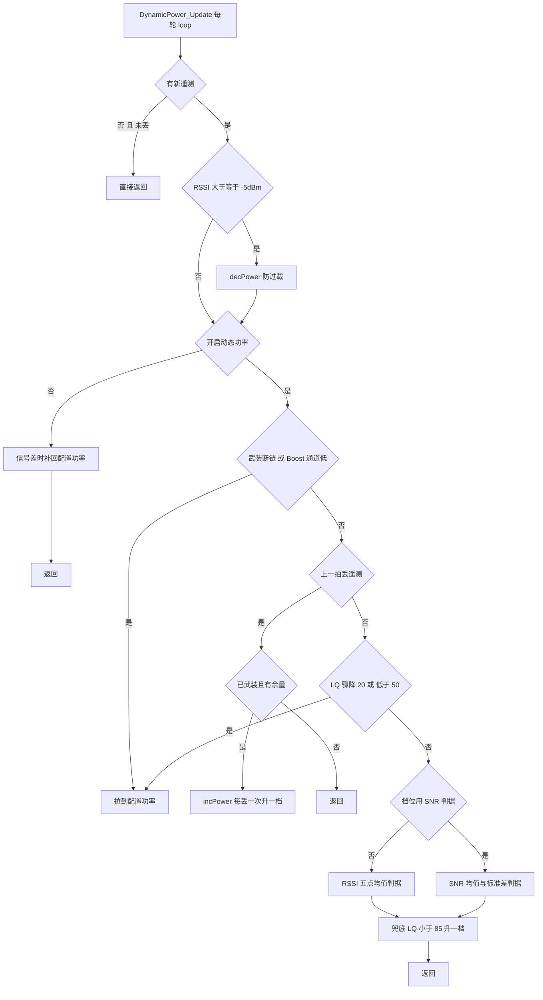
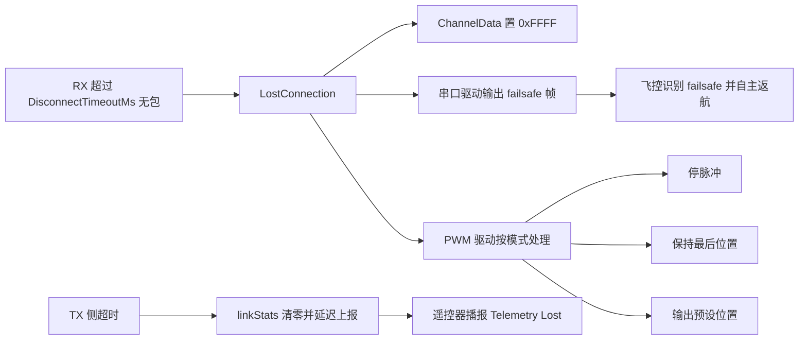
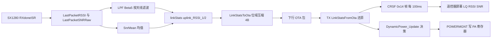

# ExpressLRS 源码详解 03：链路质量与自适应速率

> 涉及文件：
> - `src/src/dynpower.cpp`（动态功率决策，290 行）
> - `src/include/dynpower.h`（哨兵常量与接口）
> - `src/lib/LQCALC/LQCALC.h`（LQ 滑动窗口）
> - `src/src/tx_main.cpp`（`LinkStatsFromOta()` 193 行、`UpdateConnectDisconnectStatus()` 1128 行）
> - `src/src/rx_main.cpp`（`getRFlinkInfo()` 304 行、`minLqForChaos()` 279 行、`LinkStatsToOta()` 502 行）
> - `src/lib/MeanAccumulator/`（SNR 均值）
> - `src/lib/StdevAccumulator/`（SNR 标准差）
> - `Docs/07-实测与调参指南.md`（实测方法，同目录）

---

## 1. 三个物理量，三种用途

ELRS 用三个量描述链路，它们不是冗余的，各有分工：

| 量 | 单位 | 采样点 | 物理含义 | 主要用途 |
|---|---|---|---|---|
| LQ | % | 每个包周期 | 最近 100 拍的成功率 | 判断“链路是否可用” |
| RSSI | -dBm | 每个包 | 接收信号强度 | 判断“距离/功率是否够” |
| SNR | dB | 每个包 | 信号与噪声之比 | 判断“是否被噪声淹没” |

为什么不能只看一个：

- **LQ 高但 RSSI 很低**：可能只是运气好，随时会崩；
- **RSSI 高但 LQ 低**：典型同频干扰，信号很强但解不出来；
- **SNR 高但 LQ 低**：可能是同步问题（频率/时序对不上），不是信噪比问题。

动态功率算法就是在这三者之间做“投票”，见第 4 节。

---

## 2. LQ 的实现：位图滑动窗口

`LQCALC<N>` 用位图而不是队列，因为嵌入式里“移位 + 置位”比“搬数组”快得多：

```c
template <uint8_t N>
class LQCALC
{
public:
    /* Set the bit for the current period to true and update the running LQ */
    void ICACHE_RAM_ATTR add()
    {
        if (currentIsSet())
            return;
        LQArray[index] |= LQmask;
        LQ += 1;
    }

    /* Start a new period */
    void ICACHE_RAM_ATTR inc()
    {
        LQmask = LQmask << 1;
        if (LQmask == 0)
        {
            LQmask = (1 << 0);
            index += 1;
        }
        ...
    }

    /* Return the current running total of bits set, in percent */
    uint8_t ICACHE_RAM_ATTR getLQ() const
    {
        return (uint32_t)LQ * 100U / count;
    }
```

结构：`N=100` 时需要 `(100+31)/32 = 4` 个 `uint32_t`（16 字节）+ 4 个标量，
总共 20 字节。对比“用 100 字节环形缓冲”，省了 80%。

工作方式：

1. `add()`：本拍收到包 → 把当前位设 1，`LQ++`；
2. `inc()`：进入下一拍 → 掩码左移一位；移出 32 位就换下一个 word；
3. 若新位置原本是 1（说明 100 拍前那一拍也成功），`LQ--`；
4. `getLQ()` 直接 `LQ * 100 / count`，O(1) 而不是 O(N) 遍历。

`count` 的处理很讲究：

```c
    void reset()
    {
        // count is intentonally not zeroed here to start LQ counting up from 0
        // after a failsafe, instead of down from 100. Use reset100() to start from 100
        LQ = 0;
        ...
    }
```

- 掉线后用 `reset()`：`count` 保留，LQ 从 0 开始**爬升**（让用户看到“正在恢复”）；
- 换档后用 `reset100()`：`count=1`，LQ 直接显示 100（避免刚换档就报 0 吓人）。

RX 上有两个实例：

| 实例 | 用途 | 更新时机 |
|---|---|---|
| `LQCalc` | 普通单发包 | 每收到一个 RC 包 `add()` |
| `LQCalcDVDA` | 多连发档（numOfSends>1） | 每组最后一包结算 |

TX 上只有一个 `LqTQly`，统计的是**下行遥测**的成功率：

```c
  LastTLMpacketRecv_Ms = millis();
  LqTQly.add();
```

注意 TX 的 LQ 与 RX 的 LQ 是**两个方向**的指标，Web UI 上分别显示为
“Uplink LQ”和“Downlink LQ”。很多人把它们搞混，导致调参方向完全错。

---

## 3. RSSI 与 SNR：滤波比采样更重要

原始 RSSI 抖动可达 ±6dB，直接用它做判据会让功率疯狂跳变。所以两处都做了滤波。

### 3.1 RSSI：每天线一个 LPF

```c
LPF LPF_UplinkRSSI0(5);  // track rssi per antenna
LPF LPF_UplinkRSSI1(5);
```

`LPF(Beta=5)` 的时间常数是 `2^5 = 32` 个样本。在 500Hz 下约 64ms，
在 50Hz 下约 640ms——**速率越低，滤波窗口的绝对时间越长**，这是副作用，
调参时要意识到。

`getRFlinkInfo()`（304 行）里的关键处理：

```c
        rssiDBM = LPF_UplinkRSSI0.update(rssiDBM);
        rssiDBM2 = LPF_UplinkRSSI1.update(rssiDBM2);
        rssiDBM = (rssiDBM > 0) ? 0 : rssiDBM;
        rssiDBM2 = (rssiDBM2 > 0) ? 0 : rssiDBM2;
```

钳到 0 是因为 CRSF 的 RSSI 字段是 `uint8_t` 且用正值表示 -dBm：
若驱动返回 +3（近距离饱和），取反后是 -3，塞进 uint8_t 会变成 253，
上位机显示成“-253dBm”这种荒谬值。

### 3.2 SNR：均值 + 标准差

```c
MeanAccumulator<int32_t, int8_t, -16> SnrMean;
```

`-16` 是初值（表示“尚未采样”）。`LinkStatsToOta()` 里的用法：

```c
    if (SnrMean.getCount())
    {
        ls->SNR = SnrMean.mean();
    }
    else
    {
        ls->SNR = SnrMean.previousMean();
    }
```

为什么用 `previousMean()`：均值累加器在 `mean()` 后会重置，若本拍没有新样本，
就用上一次的结果，避免上报 0。

TX 侧的动态功率则用 `StdevAccumulator` 同时算均值与标准差：

```c
static StdevAccumulator dynpower_stat_snr;
```

标准差用来做“自适应阈值”——见下一节。

---

## 4. 动态功率：一棵带优先级的决策树

`DynamicPower_Update()`（98 行）是一个“早退式”决策树，顺序即优先级。
下面这张图是完整流程，节点里标了对应的宏：



### 4.1 阈值表

| 宏 | 值 | 行号 | 含义 |
|---|---|---|---|
| `DYNPOWER_LQ_BOOST_THRESH_DIFF` | 20 | 46 | LQ 相对均值骤降 20 点 → 立刻拉满 |
| `DYNPOWER_LQ_BOOST_THRESH_MIN` | 50 | 47 | LQ 绝对值低于 50 → 立刻拉满 |
| `DYNPOWER_LQ_MOVING_AVG_K` | 8 | 48 | LQ 滑动平均窗口（2 的幂，用移位） |
| `DYNPOWER_LQ_THRESH_UP` | 85 | 49 | 低于此值且无人动作 → 兜底升一档 |
| `DYNPOWER_RSSI_CNT` | 5 | 52 | RSSI 直均值样本数 |
| `DYNPOWER_RSSI_THRESH_UP` | 15 | 53 | RSSI < 灵敏度+15 → 升功率 |
| `DYNPOWER_RSSI_THRESH_DN` | 21 | 54 | RSSI > 灵敏度+21 → 降功率 |
| `DYNPOWER_LQ_THRESH_DN` | 95 | 57 | 降功率要求 LQ ≥ 95 |

“升阈 15 / 降阈 21”之间的 6dB 是**迟滞带**。没有它，RSSI 在阈值附近抖动时
功率会每个包切换一次，既费电又干扰别人。

### 4.2 SNR 判据里的“模糊逻辑”

这是全文件最精巧的一段（239~246 行）：

```c
      int32_t scale_factor_numerator = 13;
      if (lq_current < 100) {
        // scale factor will be 1 (=-0.25 sd for power up threshold) when LQ is 85
        scale_factor_numerator = std::max((int32_t)(scale_factor_numerator - ((100 - lq_current) * (scale_factor_numerator - 1)) / 15), (int32_t)1);
      }

      int8_t snr_thre_up_scaled = static_cast<int8_t>((snr_stat_mean - (snr_stat_stdev * scale_factor_numerator) / 4) / 16);
      int8_t snr_thre_dn_scaled = static_cast<int8_t>((snr_stat_mean + (snr_stat_stdev / 2)) / 16);
      int8_t snr_thre_up_limit = snr_thre_dn_scaled - SNR1dB;
```

量化解释：

| LQ | `scale_factor_numerator` | 升功率阈值 = 均值 - kσ | 行为 |
|---|---|---|---|
| 100 | 13 | 均值 - 3.25σ | 很保守，只有明显低于历史分布才升 |
| 92 | 7 | 均值 - 1.75σ | 中等 |
| 85 | 1 | 均值 - 0.25σ | 很激进，稍微低一点就升 |

设计意图：**LQ 越差，越倾向于“宁可多花功率也不要断”**。这比固定阈值更符合
实际飞行——远处 LQ 已经在掉，此时任何 SNR 下降都可能是致命的。

`snr_thre_up_limit = snr_thre_dn_scaled - SNR1dB` 保证升/降阈值至少差 1dB，
防止两个判据重叠导致同一拍既升又降。

### 4.3 升功率的“等效增益”模型

```c
    while ((snrScaled <= snr_stat_threshold_up) && (powerHeadroom > 0) && isSignalBad)
    {
      DBGLN("+power (snr) %d <= %d", snrScaled, snr_stat_threshold_up);
      POWERMGNT::incPower();
      // Every power doubling will theoretically increase the SNR by 3dB, but closer to 2dB in testing
      snrScaled += SNR_SCALE(2);
      --powerHeadroom;
    }
```

注意 `snrScaled += SNR_SCALE(2)`：每升一档，**假装** SNR 提高了 2dB，然后继续比较。
这是一种“预估补偿”——如果实际只提高了 1.5dB，循环会多升一档，属于安全侧偏差。
注释里写“理论 3dB，实测约 2dB”，这个差异来自 PA 压缩与天线失配。

---

## 5. RX 侧的功率跟随

RX 的发射功率只有两种策略（`dynpower.cpp` 296 行）：

| 配置 | 行为 | 适用场景 |
|---|---|---|
| `PWR_MATCH_TX` | 跟随 TX 上报的 `uplink_TX_Power` | 想双向对称，省电 |
| 固定档位 | 恒定输出 | 远距回传，需要最大功率 |

```c
  if (config.GetPower() != PWR_MATCH_TX)
  {
    POWERMGNT::setPower((PowerLevels_e)config.GetPower());
  }
  else
  {
    static uint8_t powerLevel = 0;
    if (linkStats.uplink_TX_Power != powerLevel)
    {
      powerLevel = linkStats.uplink_TX_Power;
      PowerLevels_e newPower = crsfPowerToPower(linkStats.uplink_TX_Power);
      DBGLN("Matching TX power %u", newPower);
      POWERMGNT::setPower(newPower);
    }
```

`static uint8_t powerLevel` 是缓存：只有 TX 上报值变化才重新写 PA 寄存器。
PA 切换有建立时间，频繁写会引入毛刺。

---

## 6. 失控保护：三个层次的“最后一道防线”

ELRS 的 failsafe 不是一个函数，而是三层协作：



### 6.1 RX 侧：`LostConnection()`

`rx_main.cpp` 的 `LostConnection()`（964 行）做七件事：

| 动作 | 目的 |
|---|---|
| `setConnectionState(disconnected)` | 通知所有设备 |
| `RXtimerState = tim_disconnected` | 相位环回到粗调 |
| `hwTimer::resetFreqOffset()` | 清频偏补偿（下次可能换了对端） |
| `LQCalc.reset()` | LQ 从 0 重新爬 |
| `LPF_Offset.init(0)` | 清相位滤波 |
| `OtaResetChannelDataComplete()` | 强制下一帧全通道重收 |
| `SetRFLinkRate(ExpressLRS_nextAirRateIndex)` | 回到候选档位重新守听 |

注意它**不清 ChannelData**——通道清空是在 `TentativeConnection()` 里做的。
这个区分很重要：短暂掉线时保持最后通道值（配合 PWM 的“保持位置”模式），
只有确认重新同步时才清空，避免舵机在掉线瞬间乱跳。

### 6.2 PWM 侧：三种 failsafe 模式

`common.h` 定义了三种策略：

| 枚举 | 行为 | 风险 |
|---|---|---|
| `PWMFAILSAFE_NO_PULSES` | 停止输出脉冲 | 飞控可能识别为“接收机掉电” |
| `PWMFAILSAFE_LAST_POSITION` | 保持最后值 | 油门保持 → 可能飞走 |
| `PWMFAILSAFE_SET_POSITION` | 输出预设值 | 需要用户提前设定 |

没有“正确”选项，只有“适合你的机型”。固定翼通常选 `SET_POSITION`（收油+盘旋），
多旋翼通常选 `NO_PULSES`（让飞控自己 failsafe）。

### 6.3 TX 侧：延迟播报，避免刷屏

`checkSendLinkStatsToHandset()`（`tx_main.cpp` 1690 行）里：

```c
      constexpr uint32_t LOST_NOTIFICATION_MAX_DELAY_MS = 3000U;
      // Delay a variable amount based on the LQ. Lower LQ, lower time before we tell the handset what's up
      uint32_t TelemetryLostCalloutDelay_Ms = map(constrain(linkStats.uplink_Link_quality, 50, 100), 50, 100, 0, LOST_NOTIFICATION_MAX_DELAY_MS);
      if (now - RxDisconnected_Ms > TelemetryLostCalloutDelay_Ms)
      {
        RxDisconnected_Ms = 0;
        linkStats.uplink_Link_quality = 0;
      }
```

映射关系：

| 断线时 LQ | 播报延迟 |
|---|---|
| 50 | 0 ms（立刻报） |
| 75 | 1500 ms |
| 100 | 3000 ms |

逻辑是“LQ 本来就低，用户已经有心理准备，不用等；LQ 突然从 100 掉下来，
可能是瞬时干扰，等 3 秒再报以免误报”。

---

## 7. 自适应速率：ELRS 没有“自动降速”

一个常见误解：ELRS 会像 Wi-Fi 一样自动降速率。**不会。**
速率是用户配置的固定值，运行期只会在两种情况下改变：

1. **TX 端按波特率钳制**：`adjustPacketRateForBaud()` 保证
   `interval * numOfSends >= 遥控器出帧间隔`，否则会把 1000Hz 降到 500Hz；
2. **RX 端轮询**：未连接时 `cycleRfMode()` 逐个档位试，直到收到 SYNC；
   连上后如果开了 `lock_on_first_connection` 就锁定不再换。

```c
static void cycleRfMode(unsigned long now)
{
    if (connectionState == connected || connectionState == wifiUpdate || InBindingMode)
        return;

    if (LockRFmode == false && (now - RFmodeLastCycled) > (cycleInterval * RFmodeCycleMultiplier))
    {
        RFmodeLastCycled = now;
        LastSyncPacket = now;
        SetRFLinkRate(scanIndex % RATE_MAX, false);
        LQCalc.reset100();
        LQCalcDVDA.reset100();
        scanIndex++;
        Radio.RXnb();
```

时间参数 `cycleInterval * RFmodeCycleMultiplier` 的取值：

| 状态 | multiplier | 实际等待（900M 50Hz 为例） |
|---|---|---|
| 刚上电 | `RFmodeCycleMultiplierSlow / 2` = 5 | 5 × cycleInterval |
| 换档后（FAST_SYNC） | 1 | 1 × cycleInterval |
| 收到过包 | `RFmodeCycleMultiplierSlow` = 10 | 10 × cycleInterval |

`cycleInterval` 的定义（`SetRFLinkRate()` 547 行）：

```c
    // Wait for (11/10) 110% of time it takes to cycle through all freqs in FHSS table (in ms)
    cycleInterval = ((uint32_t)11U * FHSSgetChannelCount() * ModParams->FHSShopInterval * interval) / (10U * 1000U);
```

以 FCC915（40 频道）、50Hz（interval=20000us）、跳频间隔 4 为例：

```
cycleInterval = 11 * 40 * 4 * 20000 / (10 * 1000) = 3520 ms
```

即“扫完整个跳频表要 3.2 秒”，乘以 10 就是 35 秒才换下一个档位。
这就是为什么“换了速率后 RX 要等很久才连上”——它在按自己的节奏轮询，
而 TX 的 sync spam 只有 10 次（约 200ms），很容易错开。

**实用结论**：改速率后如果 30 秒还没连上，手动给 RX 断电重启，
它会从 `config.GetRateInitialIdx()`（上次成功的档位）开始试，快得多。

---

## 8. 数据流：从射频到用户看到的数字



---

## 9. 陷阱与实测建议

| 陷阱 | 现象 | 排查 |
|---|---|---|
| 把 TX 的 LQ 当成 RX 的 LQ | 调参方向反了 | 看 Web UI 的 Uplink/Downlink 标签 |
| 在 50Hz 下调 `DYNPOWER_LQ_MOVING_AVG_K` | 反应慢半分钟 | 窗口是“拍数”，不是时间 |
| 只看 RSSI 不看 SNR | 近距离正常、远距离突然断 | 干扰环境下 RSSI 会骗人 |
| 忽略 `powerHeadroom` | 配置 10mW 却期望升到 100mW | 上限就是用户配置值 |
| 在武装状态下降功率 | 飞行中链路抖动 | 代码已禁止，别改 |

实测建议（配合 `Docs/07`）：

1. **静态测灵敏度**：把 TX 设为最小功率，RX 放远到 LQ 开始掉，记录 RSSI/SNR；
   换档位重复，得到“档位-灵敏度”曲线，与 `common.cpp` 表里的 `RXsensitivity` 对照。
2. **动态功率观察**：打开 `DEBUG_LOG`，`DynamicPower_Update()` 里每个分支都有
   `DBGLN("+power (snr) ...")`，串口会打印决策原因。走远再走回，
   看它是否按预期升降。
3. **验证迟滞**：站在阈值附近不动，观察功率是否稳定。若每秒跳一次，
   说明 RSSI 噪声超过 6dB 迟滞带，需要加大 `DYNPOWER_RSSI_THRESH_DN`。
4. **failsafe 演练**：拆桨，解锁后直接给 RX 断电，确认飞控进入 failsafe
   且电机停转；再测“关 TX”与“遮挡天线”两种场景，行为应当一致。
