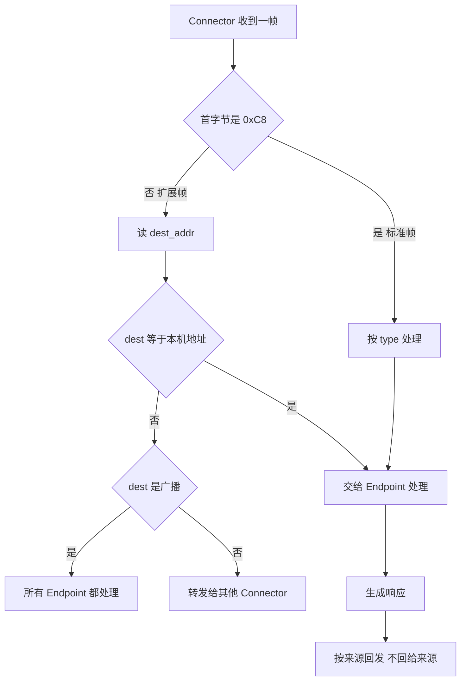
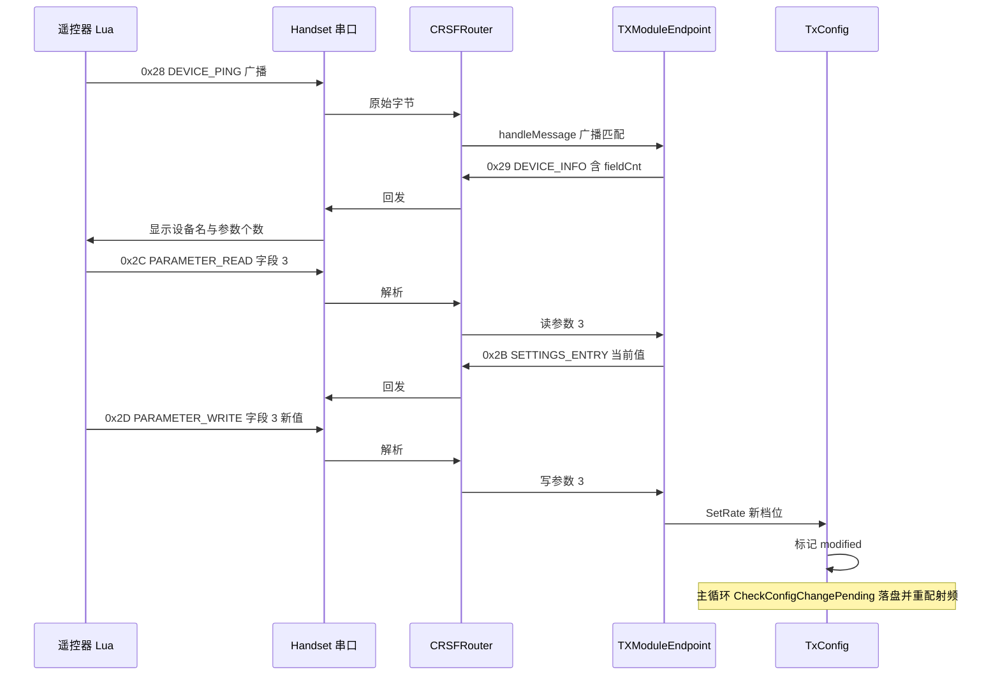

# ExpressLRS 源码详解 04：CRSF 协议对接

> 涉及文件：
> - `src/include/crsf_protocol.h`（553 行，帧格式与常量）
> - `src/lib/CrsfProtocol/`（`CRSFRouter` / `CRSFEndpoint` / `CRSFConnector`）
> - `src/lib/tx-crsf/TXModuleEndpoint.cpp`（TX 侧的设备描述）
> - `src/lib/rx-crsf/RXEndpoint.cpp`（RX 侧的设备描述）
> - `src/src/tx_main.cpp`（`ProcessMSPPacket()` 1305 行、`checkSendLinkStatsToHandset()`）
> - `src/src/rx_main.cpp`（`checkSendLinkStatsToFc()` 2221 行）
> - `src/lib/Handset/`（TX 与遥控器的串口握手）
> - `src/lib/rx-crsf/devRXLUA.cpp`（Lua 参数界面）

---

## 1. CRSF 是什么，ELRS 用到哪一部分

CRSF（Crossfire）是 TBS 定义的串口协议，现在被 Betaflight / EdgeTX / OpenTX
广泛支持。ELRS 只用了它的一个子集：

| 用途 | 帧类型 | 方向 | 频率 |
|---|---|---|---|
| 遥控通道 | `0x16` CHANNELS_PACKED | 遥控器 → TX | 每 2~4ms |
| 链路统计 | `0x14` LINK_STATISTICS | TX ↔ 遥控器 / RX → 飞控 | 100ms |
| 设备发现 | `0x28` DEVICE_PING | 双向 | 按需 |
| 设备信息 | `0x29` DEVICE_INFO | 响应 ping | 按需 |
| 参数读写 | `0x2B/0x2C/0x2D` | 遥控器 ↔ TX/RX | 按需（Lua 界面） |
| 命令 | `0x32` COMMAND | 遥控器 → TX/RX | 按需（绑定等） |
| MSP 透传 | `0x7A/0x7B/0x7C` | 双向 | 按需（VTX、背包） |

ELRS **不实现** CRSF 的完整设备树，只做一个“会转发的最小节点”。

---

## 2. 帧格式：一个字节的长度字段是万恶之源

标准帧（`crsf_header_t`）：

```c
typedef struct crsf_header_s
{
    uint8_t sync_byte;
    uint8_t frame_size;  // counts size after this byte, so it must be the payload size + 2 (type and crc)
    crsf_frame_type_e type;
    uint8_t payload[0];
} PACKED crsf_header_t;
```

| 偏移 | 字段 | 说明 |
|---|---|---|
| 0 | `sync_byte` | 固定 `0xC8`（`CRSF_SYNC_BYTE`） |
| 1 | `frame_size` | **不含 sync 与自身**，= payload + type + crc |
| 2 | `type` | 帧类型（见上表） |
| 3..n-2 | `payload` | 负载 |
| n-1 | `crc` | CRC8，多项式 `0xD5` |

长度字段的坑：`frame_size` 计的是“本字节之后”的长度，所以一整帧的字节数是
`frame_size + 2`（sync + size 两字节）。`CRSF_FRAME_SIZE(payload_size)` 宏：

```c
#define CRSF_FRAME_SIZE(payload_size) ((payload_size) + 2) // See crsf_header_t.frame_size
```

扩展帧（0x28~0x96）多两个字节：

```c
typedef struct crsf_ext_header_s
{
    // Common header fields, see crsf_header_t
    uint8_t device_addr;
    uint8_t frame_size;
    crsf_frame_type_e type;
    // Extended fields
    crsf_addr_e dest_addr;
    crsf_addr_e orig_addr;
    uint8_t payload[0];
} PACKED crsf_ext_header_t;
```

注意首字节不叫 `sync_byte` 而叫 `device_addr`——扩展帧的首字节是**目标地址**
而不是 0xC8。这是 CRSF 规范里最反直觉的一点，解析器必须靠“首字节是否 0xC8”
来区分标准帧与扩展帧。

---

## 3. 通道帧 0x16：16 × 11bit = 22 字节

```c
typedef struct crsf_channels_s
{
    unsigned ch0 : 11;
    unsigned ch1 : 11;
    ...
    unsigned ch15 : 11;
} PACKED crsf_channels_t;
```

16 × 11 = 176 bit = 22 字节，正好塞进 26 字节的帧（22 payload + type + crc + 2 头）。

通道值的量化体系：

| 名称 | 值 | 对应 | 说明 |
|---|---|---|---|
| `CRSF_CHANNEL_VALUE_EXT_MIN` | 0 | 880us | 开启扩展行程 |
| `CRSF_CHANNEL_VALUE_STD_MIN` | 172 | 988us | 标准 -100% |
| `CRSF_CHANNEL_VALUE_MID` | 992 | 1500us | 中点 |
| `CRSF_CHANNEL_VALUE_STD_MAX` | 1811 | 2012us | 标准 +100% |
| `CRSF_CHANNEL_VALUE_EXT_MAX` | 1984 | 2120us | 扩展行程 |
| `CRSF_CHANNEL_VALUE_UNSET` | 0xFFFF | — | 内部哨兵“未收到” |

换算工具（`crsf_protocol.h` 415 行起）：

```c
static uint16_t ICACHE_RAM_ATTR fmap(uint16_t x, uint16_t in_min, uint16_t in_max, uint16_t out_min, uint16_t out_max)
{
    int32_t result = ((int32_t)(x - in_min) * (out_max - out_min) * 2 / (in_max - in_min) + out_min * 2 + 1)/2;
    return result < 0 ? 0 : (result > 65535 ? 65535 : result);
}
```

先乘 2 再除 2 是为了**四舍五入**（整数除法会截断）。这个细节在 1000 档以上的
映射里能差 1 个 LSB，对舵机无所谓，但对“通道值必须精确回到 992”的自检有影响。

常用转换：

| 函数 | 输入 | 输出 | 用途 |
|---|---|---|---|
| `CRSF_to_US()` | 172..1811 | 988..2012 | 驱动 PWM/SBUS |
| `UINT10_to_CRSF()` | 0..1023 | 172..1811 | 摇杆 ADC 采样 |
| `CRSF_to_UINT10()` | 172..1811 | 0..1023 | OTA 压缩 |
| `N_to_CRSF(val, max)` | 0..max | 1000..2000 | 多档开关 |
| `CRSF_to_N(val, cnt)` | 通道值 | 0..cnt-1 | 解析多档开关 |
| `CRSF_to_BIT()` | 通道值 | 0/1 | 二值开关 |
| `CRSF_to_SWITCH3b()` | 通道值 | 0..5 或 7 | 六档 + 中位 |

`CRSF_to_SWITCH3b()` 里的“7 表示中位”是一个 hack：

```c
    // If channel is within 1/4 a BIN of being in the middle use special value 7
    if (ch < (CRSF_CHANNEL_VALUE_MID-CHANNEL_BIN_SIZE/4)
        || ch > (CRSF_CHANNEL_VALUE_MID+CHANNEL_BIN_SIZE/4))
        return CRSF_to_N(ch, CHANNEL_BIN_COUNT);
    return 7;
```

因为六档开关的物理中位落在“第 3 档与第 4 档之间”，用 0..5 无法表达，
所以留了 7 这个特殊值。`SWITCH3b_to_CRSF()` 是它的逆运算。

---

## 4. 链路统计帧 0x14：10 字节描述整条链路

```c
typedef struct crsfPayloadLinkstatistics_s
{
    uint8_t uplink_RSSI_1;
    uint8_t uplink_RSSI_2;
    uint8_t uplink_Link_quality;
    int8_t uplink_SNR;
    uint8_t active_antenna;
    uint8_t rf_Mode;
    uint8_t uplink_TX_Power;
    uint8_t downlink_RSSI_1;
    uint8_t downlink_Link_quality;
    int8_t downlink_SNR;
} PACKED crsfLinkStatistics_t;
```

方向语义必须先厘清：

| 字段 | 谁测量 | 含义 |
|---|---|---|
| `uplink_RSSI_*` | RX | TX 的信号在 RX 处有多强 |
| `uplink_Link_quality` | RX | TX→RX 的成功率 |
| `uplink_SNR` | RX | TX 信号的信噪比 |
| `downlink_RSSI_1` | TX | RX 的遥测在 TX 处有多强 |
| `downlink_Link_quality` | TX | RX→TX 的成功率 |
| `downlink_SNR` | TX | 遥测的信噪比 |

所以“uplink 差”意味着**遥控可能失控**，“downlink 差”只意味着**看不到遥测**。
两者的紧急程度完全不同。

ELRS 还扩展了一个字节：

```c
typedef struct elrsLinkStatistics_s : crsfLinkStatistics_t
{
    uint8_t downlink_RSSI_2;
} PACKED elrsLinkStatistics_t;
```

这是 ELRS 私有扩展（真分集的第二根天线），标准 CRSF 设备会忽略多余的字节。

生成与分发（`CRSFRouter::makeLinkStatisticsPacket()`，`CRSFRouter.cpp:123`）：

```c
void CRSFRouter::makeLinkStatisticsPacket(crsf_header_t *frame)
```

调用点在两侧各一处：

| 侧 | 函数 | 频率 | 目的地 |
|---|---|---|---|
| TX | `checkSendLinkStatsToHandset()` | 每 `tlm_report_interval`（默认 100ms） | 遥控器 + 背包 |
| RX | `checkSendLinkStatsToFc()` | 每 100ms（`SEND_LINK_STATS_TO_FC_INTERVAL`） | 飞控 |

RX 侧那个“断线也要发”的设计值得注意：

```c
        if ((connectionState != disconnected && connectionHasModelMatch && teamraceHasModelMatch) ||
            connectionState == disconnected)
```

条件等价于“只要不是‘有连接但型号不匹配’，就发”。断线时发的是全 0 的统计，
飞控据此触发 failsafe——**不发反而更危险**。

---

## 5. 路由：Endpoint 与 Connector

ELRS 的 CRSF 不是“一个串口读写”，而是一个小型路由网络：

| 概念 | 类 | 职责 | 实例 |
|---|---|---|---|
| Endpoint | `CRSFEndpoint` | 消息的最终处理者（有设备地址） | `crsfTransmitter`（TX）、`crsfReceiver`（RX） |
| Connector | `CRSFConnector` | 消息的物理出入口（串口/USB/OTA） | `otaConnector`、`usbConnector`、`Handset` |
| Router | `CRSFRouter` | 按目标地址把消息从 connector 转到 endpoint 或另一个 connector | `crsfRouter` |

TX 的注册顺序（`tx_main.cpp` `setup()` 1743~1726 行）：

```c
      crsfTransmitter.begin();
      crsfRouter.addConnector(&otaConnector);
      crsfRouter.addEndpoint(&crsfTransmitter);
      crsfRouter.addConnector(&usbConnector);
```

注意 `Handset`（遥控器串口）**不在这里注册**——它由 `devHandset` 在检测到
CRSF 波特率后自己 `addConnector()`。这就是为什么注释写
“When a CRSF handset is detected, it will add itself to the router”。

路由决策（简化）：



`deliverMessage(&otaConnector, ...)` 里的第一个参数是“**来源**”，
用于避免把消息回灌给发送者。这个设计在 `checkSendLinkStatsToHandset()` 里
有明确注释：

```c
    // the linkStats originates from the OTA connector so we don't send it back there.
    crsfRouter.deliverMessage(&otaConnector, &linkStatisticsFrame.h);
```

---

## 6. MSP 透传：58 字节的分片游戏

CRSF 定义了三种 MSP 帧：

| 类型 | 方向 | 负载上限 | 用途 |
|---|---|---|---|
| `0x7A` MSP_REQ | 请求 | 8 字节 | 读 MSP 状态 |
| `0x7B` MSP_RESP | 响应 | 58 字节 | 返回数据 |
| `0x7C` MSP_WRITE | 写入 | 8 字节 | 发命令 |

为什么是 8 和 58：这是 OpenTX 时代遥控器内部缓冲区的历史限制
（`CRSF_MSP_REQ_PAYLOAD_SIZE` / `CRSF_MSP_RESP_PAYLOAD_SIZE`）。

```c
#define CRSF_MSP_REQ_PAYLOAD_SIZE 8
#define CRSF_MSP_RESP_PAYLOAD_SIZE 58
#define CRSF_MSP_MAX_PAYLOAD_SIZE (CRSF_MSP_REQ_PAYLOAD_SIZE > CRSF_MSP_RESP_PAYLOAD_SIZE ? CRSF_MSP_REQ_PAYLOAD_SIZE : CRSF_MSP_RESP_PAYLOAD_SIZE)
```

一个完整 MSP 包（如 VTX 配置）远超 58 字节，所以要分片。分片信息在
负载的前几个字节：`status`、`flags`、`function`、`length`、`crc`、`payload`。

ELRS 的做法（`tx_main.cpp` `ProcessMSPPacket()` 1305 行）：

```c
  if (packet->function == MSP_SET_VTX_CONFIG)
  {
    if (packet->payload[0] < 48) // Standard 48 channel VTx table size e.g. A, B, E, F, R, L
    {
      config.SetVtxBand(packet->payload[0] / 8 + 1);
      config.SetVtxChannel(packet->payload[0] % 8);
    } else
    {
      return; // Packets containing frequency in MHz are not yet supported.
    }

    VtxTriggerSend();
```

48 = 6 频段 × 8 频道。用 `/8 + 1` 与 `%8` 把线性索引拆成（频段，频道）。
超过 48 表示“直接用 MHz 指定频率”，ELRS 不支持——这是有意的功能裁剪。

---

## 7. 参数系统：Lua 界面怎么读到 TX/RX 的配置

CRSF 的参数协议是一套“目录树”：

| 帧 | 作用 | 关键字段 |
|---|---|---|
| `0x29` DEVICE_INFO | 报告设备名、序列号、参数个数 | `fieldCnt`、`parameterVersion` |
| `0x2B` PARAMETER_SETTINGS_ENTRY | 返回一个参数的描述（类型/名称/范围） | 字段 ID、chunk |
| `0x2C` PARAMETER_READ | 按字段 ID 读取当前值 | 字段 ID |
| `0x2D` PARAMETER_WRITE | 按字段 ID 写入新值 | 字段 ID + 值 |

参数类型枚举（`crsf_value_type_e`）：

| 值 | 类型 | 额外字段 |
|---|---|---|
| 0..8 | UINT8/INT8/…/FLOAT | 最小/最大/默认值 |
| 9 | TEXT_SELECTION | 选项字符串表 |
| 10 | STRING | 自由文本 |
| 11 | FOLDER | 子目录（Lua 里显示为可展开） |
| 12 | INFO | 只读提示 |
| 13 | COMMAND | 按钮（如“Bind”） |
| 15 | VTX | VTX 表专用 |
| 127 | OUT_OF_RANGE | 请求越界 |

隐藏标志：

```c
#define CRSF_FIELD_HIDDEN       0x80     // marked as hidden in all LUA responses
#define CRSF_FIELD_TYPE_MASK    ~(CRSF_FIELD_HIDDEN)
```

`0x80` 与类型值按位或，Lua 端用掩码取出真实类型。这样“隐藏参数”不需要
额外的字段，省了一个字节——在 58 字节的响应里很宝贵。

ELRS 的参数表定义在 `CRSFParameters.cpp` 里，TX 与 RX 各一份。
`MAX_CRSF_PARAMETERS` 是 64，意味着最多 64 个可配置项。

---

## 8. 串口电气层：不只是波特率

CRSF 标准是 420000 baud、8N1、**非反相**。但实际硬件有几种变体：

| 变体 | 波特率 | 校验 | 反相 | 典型设备 |
|---|---|---|---|---|
| CRSF | 420000 | 8N1 | 否 | 大多数遥控器 |
| Inverted CRSF | 420000 | 8N1 | 是 | 部分 F4 飞控 |
| SBUS | 100000 | 8E2 | 是 | Futaba 生态 |
| SUMD | 115200 | 8N1 | 否 | Graupner |
| MAVLink | 460800 | 8N1 | 否 | 地面站 |
| HoTT | 19200 | 8N2 | 否 | Graupner 遥测 |

RX 侧的映射代码在 `setupSerial()`（`rx_main.cpp` 1498 行）：

```c
    else if (config.GetSerialProtocol() == PROTOCOL_SBUS || config.GetSerialProtocol() == PROTOCOL_INVERTED_SBUS || config.GetSerialProtocol() == PROTOCOL_DJI_RS_PRO)
    {
        sbusSerialOutput = true;
        serialBaud = 100000;
    }
```

ESP32 上还有一个“反相修复”（`ARDUINO_CORE_INVERT_FIX`，`rx_main.cpp` 65 行起）：

```c
    #if defined(ARDUINO_CORE_INVERT_FIX)
    if(invert == false)
    {
        uart_set_line_inverse(0, UART_SIGNAL_INV_DISABLE);
    }
    #endif
```

这是绕过 Arduino 核心 bug 的临时补丁（issue #2609）：核心在非反相模式下
仍会保留上一次的反相位，导致换协议后串口全是乱码。

---

## 9. 一次“遥控器改参数”的完整时序



注意最后两步：**写参数不会立刻生效**，只是把 `config` 标记为 modified。
真正的落盘与射频重配由主循环的 `CheckConfigChangePending()` 完成（见
`Docs/01` 第 6 节）。这样做的原因是参数写入可能来自 ISR 上下文（OTA 转发），
不能在那里做 Flash 写。

---

## 10. 数据流：一帧 CRSF 的旅程


---

## 11. 陷阱与实测建议

| 陷阱 | 现象 | 原因 |
|---|---|---|
| 把 `frame_size` 当总长度 | 解析错位、CRC 失败 | 它是“sync 之后”的长度 |
| 扩展帧首字节当 0xC8 校验 | 所有设备信息帧被丢 | 扩展帧首字节是 dest_addr |
| 通道值直接用 0..2047 | 舵机行程不对 | 必须映射到 172..1811 |
| MSP 响应超 58 字节不分片 | 遥控器花屏/丢参数 | 必须按 chunk 分片 |
| 反相 CRSF 当普通 CRSF | 完全无数据 | 检查 `PROTOCOL_INVERTED_CRSF` |
| 忽略 `CRSF_FIELD_HIDDEN` | Lua 里出现不该出现的项 | 类型值要 `& ~0x80` |

实测建议：

1. 用 USB-TTL 抓遥控器到 TX 的串口，先确认 `0xC8` 帧头与 `frame_size` 是否自洽；
2. 把 `DEBUG_LOG` 打开，`CRSFParser` 会打印无法解析的字节，能快速定位波特率错误；
3. 用 `crsf_protocol.h` 里的 `htobe16/32` 检查字节序——CRSF 全是大端，
   在 little-endian 的 ESP32 上很容易忘记转换；
4. 改参数后若“界面显示了但没生效”，检查 `config.IsModified()` 是否被主循环消费，
   而不是怀疑协议。
