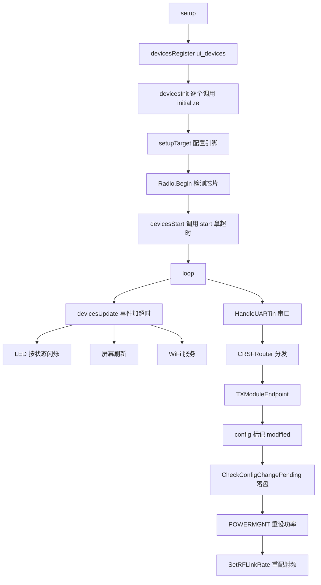
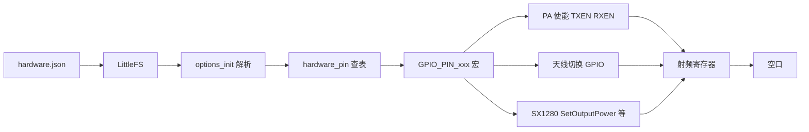

# ExpressLRS 源码详解 05：收发机硬件抽象与目标配置

> 涉及文件：
> - `src/platformio.ini`（构建入口）
> - `src/targets/common.ini`（射频芯片/编译选项）
> - `src/targets/esp32-tx.ini` 等 8 个平台 ini
> - `src/include/targets.h`（编译期总闸门，84 行）
> - `src/include/hardware.h`（运行时描述符枚举，186 行）
> - `src/lib/DEVICE/device.h`（设备框架）
> - `src/lib/SX1280Driver/SX1280.h` / `SX1280Driver.h`（射频驱动接口）
> - `src/lib/POWERMGNT/POWERMGNT.cpp`（功率与 PA 控制）
> - `src/src/tx_main.cpp`（`ui_devices[]` 112 行附近、`setupTarget()` 1589 行）

---

## 1. 三层抽象：编译期、链接期、运行时

ELRS 要支持“几百种硬件、四种射频芯片、四种 MCU”，靠的是把差异分成三层：

| 层 | 决定什么 | 载体 | 改变代价 |
|---|---|---|---|
| 编译期 | MCU 平台、TX/RX、射频芯片、监管域 | `platformio.ini` + `-D` 宏 | 重新编译 |
| 链接期 | 哪些驱动/设备参与编译 | PlatformIO `lib_ignore` | 重新编译 |
| 运行时 | 引脚、PA 曲线、屏幕型号、功能开关 | `hardware.json` + `options.json` | 改 JSON + 重启 |

这个划分的收益：**同一份固件可以烧到不同板子上**，只换 JSON。
代价：运行时读引脚要查表，所以热点路径都提前缓存。

---

## 2. 编译期：platformio.ini 的三级继承

`src/platformio.ini` 本身几乎没有内容，只有 `extra_configs`：

```ini
[platformio]
extra_configs =
	# keep common first
	targets/common.ini
	targets/esp32-tx.ini
	targets/esp32s3-tx.ini
	targets/esp32c3-tx.ini
	targets/esp8285-tx.ini
	targets/esp32-rx.ini
	targets/esp32s3-rx.ini
	targets/esp32c3-rx.ini
	targets/esp8285-rx.ini
```

`common.ini` 必须最先，因为它定义了 `[common_env_data]` 这个“基类”：

```ini
[common_env_data]
build_src_filter = +<*> -<.git/> -<svn/> -<example/> -<examples/> -<test/> -<tests/> -<*.py> -<*test*.*>
build_flags = -Wall -Iinclude -DMAVLINK_NO_SIGN_PACKET -DMAVLINK_NO_SIGNATURE_CHECK
build_flags_tx = -DTARGET_TX=1 ${common_env_data.build_flags}
build_flags_rx = -DTARGET_RX=1 ${common_env_data.build_flags}
```

射频芯片通过 `lib_ignore` 做**链接期裁剪**：

```ini
[radio_SX128X]
build_flags = -DRADIO_SX128X=1
lib_ignore =
	SX127xDriver
	LR1121Driver
	LR2021Driver
```

被 ignore 的库不参与编译，所以固件里不会出现四套驱动的符号冲突。
这是为什么 `common.h` 里可以直接写：

```c
#if defined(RADIO_SX127X)
#include "SX127xDriver.h"
#elif defined(RADIO_SX128X)
#include "SX1280Driver.h"
```

而不用担心另外三个头文件找不到。

`targets.h` 在编译期做**合法性断言**（第 61~72 行）：

```c
#elif defined(RADIO_SX127X) || defined(RADIO_LR1121) || defined(RADIO_LR2021)
#if !(defined(Regulatory_Domain_AU_915) || defined(Regulatory_Domain_FCC_915) || \
        defined(Regulatory_Domain_EU_868) || defined(Regulatory_Domain_IN_866) || \
        defined(Regulatory_Domain_AU_433) || defined(Regulatory_Domain_EU_433) || \
        defined(Regulatory_Domain_US_433) || defined(Regulatory_Domain_US_433_WIDE) || \
        defined(Regulatory_Domain_TH_920) || \
        defined(UNIT_TEST))
#error "Regulatory_Domain is not defined for 900MHz device. Check user_defines.txt!"
#endif
```

**为什么要在编译期就炸**：如果漏定义监管域，`domains[]` 数组会越界访问
（`firmwareOptions.domain` 是运行时值），表现是“上电后射频乱跳频”，
极难定位。编译期报错把问题提前到了构建阶段。

---

## 3. 运行时：hardware.json 与描述符枚举

`hardware.h` 定义了 180 多个 `nameType` 枚举值，每个对应 JSON 里的一个键：

```c
typedef enum {
    // Customisation flag
    HARDWARE_customised,
    // Serial
    HARDWARE_serial_rx,
    HARDWARE_serial_tx,
    ...
    // Radio
    HARDWARE_radio_busy,
    HARDWARE_radio_busy_2,
    HARDWARE_radio_dio0,
    ...
    HARDWARE_LAST
} nameType;
```

访问接口（同文件 180~186 行）：

```c
bool hardware_init();
int hardware_pin(nameType name);
bool hardware_flag(nameType name);
int hardware_int(nameType name);
float hardware_float(nameType name);
const int16_t* hardware_i16_array(nameType name);
const uint16_t* hardware_u16_array(nameType name);
```

| 接口 | 返回 | 典型用途 |
|---|---|---|
| `hardware_pin()` | 引脚号或 `UNDEF_PIN(-1)` | SPI/GPIO |
| `hardware_flag()` | bool | “是否有 PA”“是否反相 LED” |
| `hardware_int()` | int | 功率档数、风扇阈值 |
| `hardware_float()` | float | 电压分压比 |
| `hardware_i16_array()` | 数组指针 | `POWER_OUTPUT_VALUES` |

一个真实的调用例子（`tx_main.cpp` `setupTarget()` 1589 行附近）：

```c
  if (GPIO_PIN_ANT_CTRL != UNDEF_PIN)
  {
    pinMode(GPIO_PIN_ANT_CTRL, OUTPUT);
    digitalWrite(GPIO_PIN_ANT_CTRL, diversityAntennaState);
  }
```

`GPIO_PIN_ANT_CTRL` 是 `options.h` 里的宏，展开后就是
`hardware_pin(HARDWARE_ant_ctrl)`。所以“天线切换脚存在与否”在运行时才确定，
但代码写起来仍像编译期常量。

---

## 4. 设备框架：一个极简的协作式调度器

ELRS 没有 RTOS，但设备（LED/屏幕/按键/WiFi/风扇…）需要“周期性 + 事件驱动”。
`lib/DEVICE/device.h` 用四个函数指针解决：

```c
typedef struct {
    bool (*initialize)();   // setup() 开始时调用
    int (*start)();         // setup() 结束时调用，返回下次 timeout 的毫秒数
    int (*event)();         // 有事件时调用，返回新的超时
    int (*timeout)();       // 超时到期时调用
    uint32_t subscribe;     // 关心哪些事件（位掩码）
} device_t;
```

事件的位定义（同文件 8~30 行）：

| 事件 | 值 | 触发时机 |
|---|---|---|
| `EVENT_ARM_FLAG_CHANGED` | 1<<0 | 武装状态变化 |
| `EVENT_POWER_CHANGED` | 1<<1 | 发射功率变化 |
| `EVENT_VTX_CHANGE` | 1<<2 | VTX 参数变化 |
| `EVENT_ENTER_BIND_MODE` | 1<<3 | 进入绑定 |
| `EVENT_EXIT_BIND_MODE` | 1<<4 | 退出绑定 |
| `EVENT_MODEL_SELECTED` | 1<<5 | 模型切换 |
| `EVENT_CONNECTION_CHANGED` | 1<<6 | 连接状态变化 |
| `EVENT_CONFIG_*` | 1<<8 起 | 各类配置项变化 |

TX 的设备表（`tx_main.cpp` 112 行起）：

```c
device_affinity_t ui_devices[] = {
  {&Handset_device, 1},
  {&LED_device, 0},
  {&RGB_device, 0},
  {&TXLUA_device, 1},
  {&ADC_device, 1},
  {&WIFI_device, 0},
  {&Button_device, 0},
  ...
};
```

第二个字段是**核心亲和性**：`core=1` 表示“必须跑在主循环核心”，
`core=0` 表示“可以跑在另一个核心”（ESP32 双核）。这是个很实用的负载均衡手段：
`Handset`（串口解析）和 `TXLUA`（参数服务）放主核，`LED`/`WiFi` 放另一核。

RX 的设备表多了一个讲究（`rx_main.cpp` 100 行）：

```c
  {&Baro_device, 0}, // must come after AnalogVbat_device to slow updates
```

设备顺序会影响 `devicesUpdate()` 的调用顺序，进而影响 I2C 总线占用。
气压计放在电压采样之后，是为了让电压更新更及时（电压变化影响失控保护判断）。

---

## 5. SX1280 驱动：五个函数撑起整条射频链路

`lib/SX1280Driver/SX1280.h` 暴露的接口不多，但每个都很关键：

```c
    bool Begin();
    void Config(uint8_t bw, uint8_t sf, uint8_t cr, uint32_t freq,
                uint8_t PreambleLength, bool InvertIQ, uint8_t PayloadLength,
                uint32_t flrcSyncWord, uint16_t flrcCrcSeed, RadioBandMod::Combined modulation);
    void SetFrequencyReg(uint32_t freq, SX12XX_Radio_Number_t radioNumber, bool doRx = false);
    void SetOutputPower(int8_t power);
    void TXnb(uint8_t * data, bool sendGeminiBuffer, uint8_t * dataGemini, SX12XX_Radio_Number_t radioNumber);
    void RXnb();
```

| 函数 | 作用 | 调用点 |
|---|---|---|
| `Begin()` | 复位、读版本号、配置 DIO/TCXO | `setup()` |
| `Config()` | 写 BW/SF/CR/前导码/IQ/包长/同步字/CRC 种子 | `SetRFLinkRate()` |
| `SetFrequencyReg()` | 只改频率（跳频用，最快路径） | `HandleFHSS()` / `TXdoneISR()` |
| `TXnb()` | 非阻塞发射（DMA + 中断） | `SendRCdataToRF()` / `HandleSendDataDl()` |
| `RXnb()` | 进入接收（中断驱动） | `TXdoneISR()` / `setupRadio()` |

`TXnb()` 的四个参数值得展开：

| 参数 | 含义 | Gemini 时的特殊处理 |
|---|---|---|
| `data` | 主包缓冲 | radio1 发这个 |
| `sendGeminiBuffer` | 是否同时发第二份 | 只有 Gemini 模式为 true |
| `dataGemini` | 第二份包 | radio2 发这个（内容可能不同） |
| `radioNumber` | 用哪颗/哪几颗射频 | `All` / `1` / `2` |

`Config()` 的参数直接来自速率表的一行，所以“加档位”只需加表项，
不需要动驱动。这是 ELRS 硬件抽象做得最成功的地方。

### 5.1 中断回调的接线

```c
  Radio.RXdoneCallback = &RXdoneISR;
  Radio.TXdoneCallback = &TXdoneISR;
```

两个函数指针由驱动在 DIO 中断里调用。注意它们返回 `bool`（RX）或 `void`（TX），
返回值语义是“这个包是否被上层接受”——驱动据此决定要不要继续处理。

### 5.2 双射频与 Gemini

`SX12XX_Radio_Number_t` 有三个值：`SX12XX_Radio_1`、`SX12XX_Radio_2`、`All`。
双射频硬件靠 `GPIO_PIN_NSS_2 != UNDEF_PIN` 判定：

```c
bool ICACHE_RAM_ATTR isDualRadio()
{
    return GPIO_PIN_NSS_2 != UNDEF_PIN;
}
```

Gemini 模式在两颗射频上**同时发同一份数据**（真分集），接收端取信噪比更好的那路。
代价是功耗翻倍、且两颗 PA 同时工作发热大。所以默认模式是 `SWITCH`
（每包交替），只有远距场景才建议开 Gemini。

---

## 6. PA 控制：从“功率档”到“寄存器值”

这是硬件抽象里最“脏”的部分，因为每块板子的 PA 曲线都不同。

### 6.1 八档功率

`POWERMGNT.h` 定义了统一的功率档：

```c
typedef enum
{
    PWR_10mW = 0,
    PWR_25mW = 1,
    PWR_50mW = 2,
    PWR_100mW = 3,
    PWR_250mW = 4,
    PWR_500mW = 5,
    PWR_1000mW = 6,
    PWR_2000mW = 7,
    PWR_COUNT = 8,
    PWR_MATCH_TX = PWR_COUNT,
} PowerLevels_e;
```

`PWR_MATCH_TX` 是特殊值（=8），只用于 RX 的“跟随 TX 功率”模式，
不是真实档位。

### 6.2 四种输出方式

`POWERMGNT.cpp` 文件头注释列了全部可能：

```c
 * - `POWER_OUTPUT_DAC` to use i2c DAC specify the address of the DAC in this define
 * - `POWER_OUTPUT_DACWRITE` to use `dacWrite` function
 * - `POWER_OUTPUT_ANALOG` to use `analogWrite` function
 * - `POWER_OUTPUT_FIXED` which will provide the value to `Radio.SetOutputPower` function
 * - default is to use `Radio.SetOutputPower` function
```

| 方式 | 硬件形态 | 控制量 |
|---|---|---|
| DAC（I2C） | 外置 DAC 芯片控制 PA 偏置 | 0..255 |
| DACWRITE | ESP32 内置 DAC | 0..255 |
| ANALOG | PWM 滤波后当模拟量 | 0..255 |
| FIXED | 直接写射频芯片的功率寄存器 | -18..13 dBm |
| 默认 | 同 FIXED，但走 `POWER_OUTPUT_VALUES` 数组 | 芯片相关 |

对应代码（`POWERMGNT.cpp` 190 行附近）：

```c
    if (POWER_OUTPUT_DACWRITE)
    {
        if (POWER_OUTPUT_VALUES2 != nullptr)
        {
            Radio.SetOutputPower(SAFE_GET_POWER_VALUE(POWER_OUTPUT_VALUES2, powerIdx));
        }
        ...
        dacWrite(GPIO_PIN_RFamp_APC2, SAFE_GET_POWER_VALUE(POWER_OUTPUT_VALUES, powerIdx));
```

`SAFE_GET_POWER_VALUE` 是个防御性宏：

```c
#define SAFE_GET_POWER_VALUE(values, idx) (((idx) < (values##_COUNT)) ? (values)[idx] : (values)[0])
```

如果用户把功率配成 2000mW 但硬件只定义了 4 档，就退回第 0 档（最低），
而不是越界读数组。注释写得很直接：“Maybe the user will realize they can't just
set MaxPower to 2000mW and get more power”。

### 6.3 功率微调与防跑飞

SX1280 支持“在目标功率附近微调 ±3dB”，用于动态功率的细粒度控制：

```c
void POWERMGNT::incSX1280Output()
{
    // Power adjustment is capped to within +-3dB of the target power level to prevent power run-away
    if (CurrentSX1280Power < 13 && CurrentSX1280Power < SAFE_GET_POWER_VALUE(POWER_OUTPUT_VALUES, CurrentPower) + 3)
    {
        CurrentSX1280Power++;
        Radio.SetOutputPower(CurrentSX1280Power);
    }
}
```

±3dB 的上限是安全设计：如果只靠“加一”而不设边界，一次异常的高 RSSI 读数
可能把功率推到芯片最大值，烧 PA 或干扰整个场地。

### 6.4 功率与射频配置的顺序

`ChangeRadioParams()`（`tx_main.cpp` 946 行）：

```c
static void ChangeRadioParams()
{
  ModelUpdatePending = false;
  ResetPower(); // Call before SetRFLinkRate(). The LR1121 Radio lib can now set the correct output power in Config().
  SetRFLinkRate(config.GetRate());
  LbtEnableIfRequired();
}
```

注释说得很清楚：LR1121 的 `Config()` 内部会读当前功率档写 PA 寄存器，
所以必须先 `ResetPower()`。这个顺序在 SX1280 上无所谓，但在 LR1121 上错了
就会“配置完功率变成默认值”。

---

## 7. 天线控制：三种完全不同的机制

| 机制 | 引脚 | 代码 | 适用 |
|---|---|---|---|
| 单天线切换 | `GPIO_PIN_ANT_CTRL` | `switchDiversityAntennas()` / `switchAntenna()` | TX 分集、RX 分集 |
| 天线组选择 | `GPIO_PIN_ANT_GROUP` | `digitalWrite(GPIO_PIN_ANT_GROUP, ...)` | 多频段天线阵列 |
| 双射频 | `GPIO_PIN_NSS_2` | `isDualRadio()` + `SX12XX_Radio_2` | Gemini / 双频 |

TX 侧的天线切换时机很讲究（`timerCallback()` 814 行）：

```c
  if ((OtaNonce % ExpressLRS_currAirRate_Modparams->numOfSends == 0 || // Swicth with new packet data
      OtaNonce % ExpressLRS_currAirRate_Modparams->numOfSends == ExpressLRS_currAirRate_Modparams->numOfSends / 2) &&
      TelemetryRcvPhase == ttrpTransmitting) // Only switch when transmitting.  A diversity rx will send tlm back on the best antenna.  So don't switch away from it.
```

三个条件：新包开始时、DVDA 组中间、且**只在发射相位**。
第三条是为了不把天线从“刚收到遥测的那根”上移开——分集 RX 会从最好的天线回传，
TX 若在接收窗口切走就会丢遥测。

---

## 8. 执行流：设备与射频如何协作



---

## 9. 数据流：从 JSON 到寄存器



数据载体在各层的形态：

| 层 | 载体 | 大小 |
|---|---|---|
| JSON 文件 | 文本 | 2~20 KB |
| 解析后 | `firmwareOptions` 结构 | 数百字节 |
| 查表结果 | `int` 引脚号 | 4 B |
| 寄存器 | SPI 写入的字节 | 1~2 B |

---

## 10. 陷阱与实测建议

| 陷阱 | 现象 | 原因 |
|---|---|---|
| `NSS_2` 定义了但实际没装第二颗芯片 | `isDualRadio()` 为真，Gemini 失效 | JSON 写错 |
| `POWER_OUTPUT_VALUES` 少于档数 | 高档位输出最低功率 | `SAFE_GET_POWER_VALUE` 兜底 |
| 先 `SetRFLinkRate` 再 `ResetPower` | LR1121 功率被覆盖 | 顺序错误 |
| 天线切换放在接收窗口 | 遥测丢包 | 应只在 `ttrpTransmitting` 切 |
| 监管域漏定义 | 编译报错（好事） | `targets.h` 的 `#error` |
| 设备核心亲和性写反 | WiFi 卡顿或串口丢字节 | `core=1` 必须主核 |

实测建议：

1. **先量电压再调功率**：大功率 PA 在电池电压低时会掉功率，
   用万用表量 PA 供电，确认在规格内；
2. **用 `startCWTest()` 测 PA**：`SX1280.h` 里有这个接口，
   可以发单载波，配合频谱仪看实际输出与谐波；
3. **验证天线切换**：把 `GPIO_PIN_ANT_CTRL` 接逻辑分析仪，
   确认每个包只切一次、且不在接收窗口；
4. **JSON 改错的自救**：`hardwareUndefined` 状态下只有 WiFi 可用，
   通过 Web UI 重新上传 `hardware.json` 即可，不用拆机。
