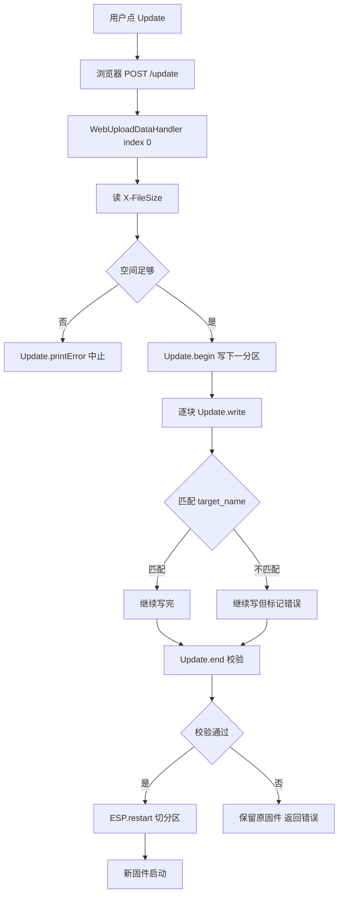
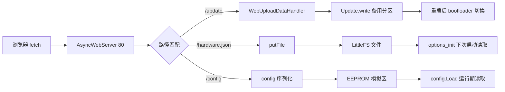

# ExpressLRS 源码详解 06：WiFi 配置与固件升级

> 涉及文件：
> - `src/lib/WIFI/devWIFI.cpp`（Web 服务、上传、MDNS、Joystick）
> - `src/lib/WIFI/devWIFI.h`（对外只有一个 `device_t`）
> - `src/lib/WIFI/TcpMspConnector.cpp`（TCP 上的 MSP 透传）
> - `src/lib/WIFI/wifiJoystick.cpp`（WiFi 手柄）
> - `src/src/rx_main.cpp`（`resetConfigAndReboot` 2383 行；`setWifiUpdateMode` 在 `devWIFI.cpp` 99 行）
> - `src/src/tx_main.cpp`（`enterWiFiUpdateMode` 相关设备代码）
> - `src/html/`（前端资源，编译进固件）
> - `src/python/build_flags.py`（把 html 打包成 `WEB_ASSETS`）

---

## 1. WiFi 不是“额外功能”，而是救砖通道

ELRS 把 WiFi 放在一个很特殊的位置：**它不是主流程的一部分，而是主流程失败时的唯一出口**。
证据在 `setup()` 的失败分支里：

```c
    if (!options_init())
    {
        // Register the WiFi with the framework
        static device_affinity_t wifi_device[] = {
            {&WIFI_device, 1}
        };
        devicesRegister(wifi_device, ARRAY_SIZE(wifi_device));
        devicesInit();

        setConnectionState(hardwareUndefined);
```

此时射频、串口、屏幕全都不初始化，**只启动 WiFi**。因为 `hardware.json` 解析失败
意味着引脚定义不可信，任何 GPIO 操作都可能短路；而 WiFi 只依赖芯片内部外设，
是唯一安全的交互方式。

---

## 2. 三种 WiFi 模式

| 模式 | 触发 | SSID | 用途 |
|---|---|---|---|
| AP（热点） | 上电未连接超时 / 按键 / OTA 命令 | `ExpressLRS TX` / `ExpressLRS RX` | 现场配置 |
| STA（STA 连接） | 用户填了家庭 WiFi | 由路由器分配 | 固件升级（有互联网） |
| 关闭 | 正常飞行 | — | 省电、减少干扰 |

AP 模式默认无密码（`wifi_hostname` 相关配置可设密码）。这是有意的取舍：
现场配置时手机直连最方便，且 AP 只在上电后短时间开启。

`captivePortal()` 处理“连上热点但没弹门户”的场景：

```c
static bool captivePortal(AsyncWebServerRequest *request)
{
  if (!isIp(request->host()) && request->host() != (String(wifi_hostname) + ".local"))
  {
    DBGLN("Request redirected to captive portal");
    request->redirect(String("http://") + toStringIp(request->client()->localIP()));
    return true;
  }
  return false;
}
```

任何“用域名访问”的请求都被 302 到 IP 根路径，这样手机自动弹出的门户页
就能直接显示配置界面，不需要用户手动输 `10.0.0.1`。

---

## 3. 有哪些 HTTP 接口

`devWIFI.cpp` 里注册的路由（按功能分组）：

| 路径 | 方法 | 作用 | 注册行（`devWIFI.cpp`） |
|---|---|---|---|
| `/networks.json` | GET | 扫描到的 WiFi 列表 | 1260 |
| `/sethome` | POST | 保存家庭 WiFi | 1261 |
| `/forget` | POST | 忘记网络 | 1262 |
| `/connect` | POST | 连接指定网络 | 1263 |
| `/config` | GET | 读运行配置（速率/功率/UID） | 1264 |
| `/access` | POST | AP/STA 模式切换 | 1265 |
| `/firmware.bin` | GET | 下载当前固件 | 1266 |
| `/update` | POST | 上传固件（OTA） | 1268 |
| `/forceupdate` | POST | 跳过目标校验上传 | 1270 |
| `/cw` | GET | 连续波测试（测 PA） | 1272 |
| `/hardware.json` | GET/POST | 读/写硬件定义 | 1279 |
| `/options.json` | GET | 读固件选项 | 1280 |
| `/reboot` | POST | 重启 | 1281 |
| `/reset` | POST | 清配置重启 | 1282 |
| `/gps` | GET | GPS 状态 | 1284 |

静态资源与根路径：

| 路径 | 处理函数 | 行号 |
|---|---|---|
| `/index.html` 等 | `WebUpdateSendContent()` | 144 |
| `/`（含 captive portal） | `WebUpdateHandleRoot()` | 157 |
| 文件上传落盘 | `putFile()` | 174 |
| 固件分块写入 | `WebUploadDataHandler()` | 905 |

静态资源不是从文件系统读的，而是**编译进固件**的 gzip 字节数组：

```c
static void WebUpdateSendContent(AsyncWebServerRequest *request)
{
  for (size_t i=0 ; i<WEB_ASSETS_COUNT ; i++) {
    if (request->url().equals(WEB_ASSETS[i].path)) {
      AsyncWebServerResponse *response = request->beginResponse(200, WEB_ASSETS[i].content_type, WEB_ASSETS[i].data, WEB_ASSETS[i].size);
      response->addHeader("Content-Encoding", "gzip");
      request->send(response);
      return;
    }
  }
  request->send(404, "text/plain", "File not found");
}
```

好处：不占 LittleFS 空间、不会因文件系统损坏而白屏；坏处：改前端必须重新编译固件。
`src/python/build_flags.py` 负责把 `src/html/` 打包成这个数组。

---

## 4. 固件上传：先验目标，再写 Flash

这是全文件最值得精读的一段，因为它防的是“刷错固件变砖”。

### 4.1 上传开始

```c
  if (index == 0) {
    #if defined(TARGET_TX) && defined(PLATFORM_ESP32)
      WifiJoystick::StopJoystickService();
    #endif

    size_t filesize = request->header("X-FileSize").toInt();
    DBGLN("Update: '%s' size %u", filename.c_str(), filesize);
    #if defined(PLATFORM_ESP8266)
    Update.runAsync(true);
    uint32_t maxSketchSpace = (ESP.getFreeSketchSpace() - 0x1000) & 0xFFFFF000;
    DBGLN("Free space = %u", maxSketchSpace);
    UNUSED(maxSketchSpace); // for warning
    #endif
    if (!Update.begin(filesize, U_FLASH)) { // pass the size provided
      Update.printError(LOGGING_UART);
    }
```

要点：

1. `X-FileSize` 是前端加的自定义头，用来预先告诉固件“总共多少字节”，
   以便 `Update.begin()` 检查空间；
2. ESP8266 要显式 `runAsync(true)`，否则上传期间会阻塞 WiFi 栈导致超时；
3. 上传前先停 WiFi Joystick 服务——它也在收 UDP 包，会抢带宽。

### 4.2 目标校验：在二进制里找 `target_name`

```c
      if (force_update || (totalSize == 0 && *data == 0x1F))
        target_seen = true;
      if (!target_seen) {
        for (size_t i=0 ; i<len ;i++) {
          if (!target_complete && (target_pos >= 4 || target_found.length() > 0)) {
            ...
            if (data[i] == 0 || target_found.length() > 50) {
              target_complete = true;
            }
            else {
              target_found += (char)data[i];
            }
          }
          if (data[i] == target_name[target_pos]) {
            ++target_pos;
            if (target_pos >= target_name_size) {
              target_seen = true;
            }
          }
          else {
            target_pos = 0; // Startover
          }
        }
```

算法：在**整个固件二进制**里做子串匹配，查找 `target_name`（如 `esp32s3_rx`）。
每收到一块数据就滑动匹配，`target_pos` 是当前匹配进度，失配就归零重来。

三个细节：

| 细节 | 含义 |
|---|---|
| `*data == 0x1F` | gzip 魔数，说明这是压缩包，直接放行（后面解压再验） |
| `force_update` | 用户点了 “Flash Anyway”，跳过校验 |
| `target_found` | 顺便把找到的字符串抓出来，用于错误提示“你刷的是 XX 目标” |

### 4.3 为什么不用“校验和/签名”

因为目标是**防止用户下错文件**，不是防攻击。子串匹配足够且零成本：
每个固件里都嵌了 `target_name` 常量，匹配上就说明是这块板子的固件。
真正的完整性由 ESP32 的 Flash 校验和与 bootloader 保证。

### 4.4 上传失败的处理

如果 `target_seen` 最终为 false，代码会返回一个 JSON 提示（`devWIFI.cpp` 900 行）：

```c
    message += "<br/><br/>Please double check you are uploading the correct target, then proceed with 'Flash Anyway'.\"}";
    request->send(200, "application/json", message);
```

注意它**没有中止写入**——数据已经写进 Flash 了。这是 ESP32 OTA 的特性：
写入的是“下一个 app 分区”，只有重启才会切换。所以即使刷错，只要不重启，
原固件仍在运行，可以重新上传正确的。

---

## 5. 升级流程全景



对应的状态与文件：

| 阶段 | 持久化位置 | 掉电后果 |
|---|---|---|
| 写入中 | 备用 app 分区 | 原固件仍可启动 |
| `Update.end()` 后 | 分区表标记为可启动 | 原固件仍可启动 |
| 重启后 | bootloader 选择新分区 | 新固件运行 |
| 新固件首次启动失败 | bootloader 回滚（如启用） | 回到旧固件 |

---

## 6. 配置读写：JSON 与 EEPROM 的分工

ELRS 有两套配置，容易混淆：

| 存储 | 内容 | 写入方式 | 掉电保持 |
|---|---|---|---|
| `hardware.json` | 引脚定义、PA 曲线 | Web 上传 | 是（LittleFS） |
| `options.json` | 功能开关、编译选项覆盖 | Web 上传 | 是（LittleFS） |
| EEPROM 区 | 速率、功率、UID、模型 ID | 运行中 `config.Commit()` | 是（Flash 模拟） |

Web 界面上的“速率/功率/TLM 比例”改的是 **EEPROM**，不是 JSON；
“目标板/引脚”改的是 **JSON**。这个区分很重要：

- 改速率 → 立即生效（`CheckConfigChangePending()` 落盘后重配射频）；
- 改引脚 → 必须重启（`hardware_init()` 只在 setup 里跑一次）。

`/reset` 接口会同时清两者：

```c
void resetConfigAndReboot()
{
    config.SetDefaults(true);
    yield();
    // Remove options.json and hardware.json
    LittleFS.format();
    yield();
    LittleFS.begin();
    options_SetTrueDefaults();

    ESP.restart();
}
```

两次 `yield()` 是喂看门狗——`LittleFS.format()` 在 ESP8266 上可能耗时数秒。

---

## 7. MDNS：让用户不用记 IP

```c
static void startMDNS()
{
  if (!MDNS.begin(wifi_hostname))
  ...
    MDNS.addServiceTxt(service, "vendor", "elrs");
    MDNS.addServiceTxt(service, "target", (const char *)&target_name[4]);
    MDNS.addServiceTxt(service, "device", (const char *)device_name);
    MDNS.addServiceTxt(service, "product", (const char *)product_name);
    MDNS.addServiceTxt(service, "version", VERSION);
    MDNS.addServiceTxt(service, "options", options.c_str());
```

TXT 记录让 Configurator 能**自动发现**局域网里的 ELRS 设备，不需要用户输入 IP。
`target_name+4` 的偏移是因为 `target_name` 前 4 字节是长度/类型头（编译期生成的
Pascal 风格字符串），真正的名字从第 5 字节开始。这个 `+4` 在 `reset_into_bootloader()`
里也出现过：

```c
    SERIAL_PROTOCOL_TX.println((const char *)&target_name[4]);
```

是同一个约定。

---

## 8. WiFi Joystick 与 TCP MSP：两个“非配置”用途

### 8.1 WiFi Joystick

TX 可以把 WiFi 当成“虚拟遥控器”：手机/电脑连上后，通过 UDP 发送摇杆数据，
TX 直接把它当 CRSF 通道用。适用于无遥控器调试。

代码在 `wifiJoystick.cpp`，`devWIFI.cpp` 里在 OTA 开始时会主动停掉它：

```c
    #if defined(TARGET_TX) && defined(PLATFORM_ESP32)
      WifiJoystick::StopJoystickService();
    #endif
```

### 8.2 TCP MSP

`TcpMspConnector` 把 MSP 协议跑在 TCP 上，让 Configurator 可以通过 WiFi
读写参数（而不是插 USB）。它实现了 `CRSFConnector` 接口，所以对路由层来说
和串口没有区别——这是第 04 篇讲的“Connector 抽象”的直接收益。

---

## 9. 数据流：从浏览器到 Flash



---

## 10. 陷阱与实测建议

| 陷阱 | 现象 | 原因 |
|---|---|---|
| 上传时断电 | 设备“变砖” | 备用分区写坏，但 bootloader 仍能进下载模式 |
| 用手机流量上传 | 超时失败 | AP 模式无互联网，必须连设备热点 |
| 改 `hardware.json` 后不重启 | 引脚不生效 | `hardware_init()` 只在 setup 跑 |
| 上传固件后配置丢失 | 速率/UID 回到默认 | 刷机时勾了“擦除 Flash” |
| MDNS 找不到设备 | Configurator 搜不到 | 路由器隔离了组播 |
| 上传大固件失败 | `Update.begin` 返回 false | 分区表没有 OTA 分区（需先串口刷一次） |

实测建议：

1. **先备份 JSON**：Web UI 的 `/hardware.json` 与 `/options.json` 可以直接 GET 下来，
   改坏了再 POST 回去；
2. **用 `curl` 验证接口**：`curl -s http://10.0.0.1/status.json | jq` 能看到
   LQ/RSSI/版本，比翻网页快；
3. **刷机前记录 UID**：刷错固件后 UID 可能丢，重绑要拆机按键；
4. **验证 OTA 分区**：连续刷两次，若第二次失败说明分区表只有单 app 分区，
   需要先串口刷一次带 OTA 的 bootloader。
