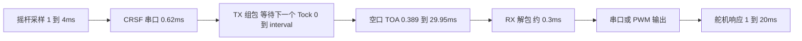
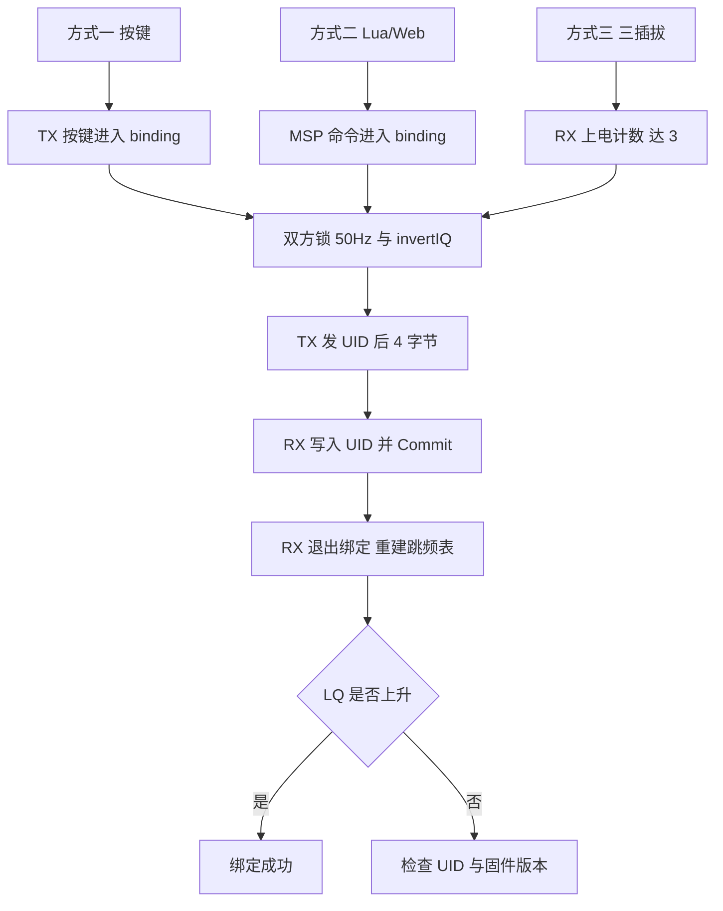
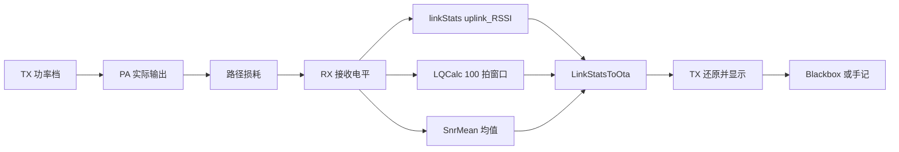

# ExpressLRS 源码详解 07：实测与调参指南

> 涉及文件：
> - `src/src/common.cpp`（速率表与灵敏度，SX127x 39~46 行、SX1280 74~84 行）
> - `src/src/rx_main.cpp`（`minLqForChaos()` 279 行、`cycleRfMode()` 1979 行）
> - `src/src/tx_main.cpp`（`UpdateConnectDisconnectStatus()` 1128 行）
> - `src/src/dynpower.cpp`（动态功率阈值，46~57 行）
> - `src/lib/POWERMGNT/POWERMGNT.cpp`（功率档位与 PA 曲线）
> - `src/lib/LQCALC/LQCALC.h`（LQ 定义）
> - `src/include/crsf_protocol.h`（通道行程与开关映射）

---

## 1. 先建立“数量级直觉”

调参前必须知道每个数字的量级，否则会把“正常现象”当成故障。
下面这张表全部可以从代码里算出来：

| 量 | 公式 | 典型值 |
|---|---|---|
| 包周期 | `ModParams->interval` | 1000us（1000Hz）~40000us（25Hz） |
| 单包空中时间 | `TOA` | 389us ~ 29950us |
| 占空比 | `TOA / interval` | 38.9% ~ 87.6% |
| CRSF 一帧传输 | `26 B × 10 bit / 420000` | 0.62 ms |
| 遥控器采样 | 由遥控器决定 | 2~4 ms |
| 飞控处理 | 由飞控决定 | 1~3 ms |
| PWM 输出周期 | 50Hz 模式 | 20 ms |

**关键结论**：在 1000Hz 档，空口只占 0.389ms，但遥控器本身每 2~4ms 才出一帧。
所以“1000Hz”并不意味着摇杆延迟 1ms——它只意味着“如果遥控器有新数据，
TX 能在 1ms 内把它发出去”。真实端到端延迟由最慢的一环决定。

---

## 2. 延迟预算：从摇杆到舵机



各段量化（以 500Hz LoRa 为例：interval=2000us，TOA=1507us）：

| 段 | 最坏耗时 | 说明 |
|---|---|---|
| 遥控器采样 | 4 ms | 取决于遥控器，不由 ELRS 决定 |
| CRSF 传输 | 0.62 ms | 26 字节 @420k |
| 等待 Tock | 0~2 ms | 平均 1ms |
| 空口 | 1.507 ms | TOA |
| RX 解包 | 0.3 ms | 估算，含 CRC 校验 |
| 输出 | 0~20 ms | PWM 50Hz 最坏要等一个周期 |
| **合计** | **≈ 8.4 ms 最坏 / 4.4 ms 典型** | 不含舵机机械延迟 |

如果只用 CRSF 输出（飞控直连），最后一段变成 0.62ms，总延迟约 4~5ms。

**实测方法**（不需要专业设备）：

1. 用示波器双通道：CH1 接遥控器 PPM/CRSF 的某位，CH2 接 RX 的 PWM 输出；
2. 打杆到极限，看两个边沿的时间差；
3. 重复 20 次取平均。这个值通常比理论值大 2~3ms，因为遥控器内部还有滤波。

---

## 3. 功率：不是越大越好

### 3.1 功率档与链路预算

`PowerLevels_e` 的八档是**标称值**，实际输出取决于 PA 与校准：

| 档位 | 标称 | 典型实际 | 电流（3.3V 供电，估） |
|---|---|---|---|
| `PWR_10mW` | 10 dBm | 9~11 dBm | 60~90 mA |
| `PWR_25mW` | 14 dBm | 13~15 dBm | 100~150 mA |
| `PWR_100mW` | 20 dBm | 19~21 dBm | 200~300 mA |
| `PWR_500mW` | 27 dBm | 25~28 dBm | 500~700 mA |
| `PWR_1000mW` | 30 dBm | 28~31 dBm | 900~1300 mA |
| `PWR_2000mW` | 33 dBm | 30~33 dBm | 1.5~2.5 A |

`POWERMGNT::getPowerIndBm()` 里的映射（`POWERMGNT.cpp` 135 行）只到 1000mW，
更高档依赖外置 PA。注意**每 3dB 才翻一倍功率**，所以从 100mW 升到 1000mW
只多 10dB，理论距离提升约 3 倍（自由空间），实际因地形往往只有 1.5~2 倍。

### 3.2 什么时候该降功率

| 场景 | 建议 | 原因 |
|---|---|---|
| 室内/近距离编队 | 10~25mW | 避免互相压制（RSSI > -5dBm 会触发过载保护） |
| 常规视距飞行 | 100~250mW | 兼顾距离与发热 |
| 远航/穿障 | 500mW~1W | 需要链路余量 |
| 竞赛多人同场 | 10mW + 定向天线 | 减少对他人的干扰 |

代码里的过载保护（`dynpower.cpp` 113 行）：

```c
  // power is too strong and saturate the RX LNA
  if (newTlmAvail && (rssi >= -5))
  {
    DBGVLN("-power (overload)");
    POWERMGNT::decPower();
  }
```

`-5dBm` 是非常强的信号（比 Wi-Fi 路由器贴脸还强）。此时 RX 的 LNA 已经饱和，
再加大功率只会让接收机更“聋”。这是很多人“越近越容易失控”的真正原因。

---

## 4. 速率：先定需求，再选档位

### 4.1 选档决策

| 需求 | 推荐档位 | 理由 |
|---|---|---|
| 竞速/花飞，要求最低延迟 | 2.4G FLRC 500~1000Hz | TOA 389us，延迟最低 |
| 常规穿越 | 2.4G LoRa 250Hz | 延迟与距离平衡 |
| 远航（5~20km） | 900M LoRa 50Hz | 灵敏度 -120dBm |
| 极远（>20km） | 900M LoRa 25Hz | 灵敏度 -123dBm |
| 城市/穿障 | 900M LoRa 50Hz | 绕射好 |
| 室内小场地 | 2.4G LoRa 150Hz | 抗 Wi-Fi 干扰尚可 |

### 4.2 速率与遥测的耦合

高速档的占空比高，留给遥测的窗口少，所以 TLM 比例必须放低：

| 档位 | interval | TOA | 占空比 | 默认 TLM |
|---|---|---|---|---|
| FLRC 1000Hz | 1000us | 389us | 38.9% | 1:128 |
| LoRa 500Hz | 2000us | 1507us | 75.4% | 1:128 |
| LoRa 250Hz | 4000us | 3300us | 82.5% | 1:64 |
| LoRa 50Hz | 20000us | 10798us | 54.0% | 1:16 |
| LoRa 25Hz | 40000us | 29950us | 74.9% | 1:8 |

规律：**占空比越高，TLM 比例越小**。这不是随便配的，而是为了让
“遥测包也能挤进剩余的 25% 空隙”。

### 4.3 为什么不要长期跑 1000Hz

1. 只有 EdgeTX 的部分遥控器能输出 1000Hz，多数是 250Hz 或 500Hz；
2. 占空比虽低，但每包都要唤醒一次射频与 MCU，**平均功耗反而更高**；
3. 抗干扰余量小：一包被打掉就是 1ms 的数据空洞，虽然下一包马上补上，
   但在强干扰环境下误码率会明显上升。

---

## 5. 天线：比功率更值得投资

| 天线类型 | 增益 | 波瓣 | 适用 |
|---|---|---|---|
| 全向棒状（默认） | 2~3 dBi | 360° 水平 | 常规 |
| 全向高增益 | 5~6 dBi | 压扁的甜甜圈 | 远航（需保持姿态） |
| 定向贴片 | 8~10 dBi | 60~90° | 固定方向远航 |
| 定向八木 | 12~15 dBi | 30~40° | 极远距离，需云台跟踪 |

三条实战经验：

1. **收发两端的天线极化要一致**（都垂直）。交叉极化会损失 20dB 以上，
   相当于功率降到 1/100；
2. **天线不能贴碳纤维/电池**，会被吸收并失谐。至少留 2cm 净空；
3. **TX 与 RX 天线不要平行得太近**（<30cm），否则近场耦合会导致失锁。

---

## 6. 绑定：三种方式与排查



| 方式 | 操作 | 适用 | 注意 |
|---|---|---|---|
| 按键 | TX 按住 bind 键上电 | 有按键的模块 | 部分模块按键是复用功能 |
| Lua/Web | 菜单里点 Bind | 有屏幕/手机 | 需要链路已建立或 WiFi 可用 |
| 三插拔 | RX 连续三次快速上电 | 无按键的 RX | 每次上电 <2 秒 |

绑定时两端必须满足：

| 条件 | TX | RX |
|---|---|---|
| 速率 | `RATE_BINDING`（50Hz） | 同左 |
| IQ | 反转 | 反转 |
| CRC 初值 | `OTA_VERSION_ID` | 同左 |
| nonce | 锁 0 | 不推进 |

**绑定失败的四个常见原因**：

1. 固件大版本不同（`OTA_VERSION_ID` 不同）→ 永远绑不上；
2. RX 处于 `BINDSTORAGE_ADMINISTERED` 模式 → 只允许 Web UI 绑定；
3. TX 的 `UID[4..5]` 全 0 → `OtaUidIsBound()` 判定未绑定，RX 会一直进绑定；
4. 距离太近（<1m）→ 接收机前端饱和，反而收不到。

第 4 条最反直觉：绑定时应把 TX 与 RX 隔开 1~2 米。

---

## 7. 常见故障排查表

| 现象 | 最可能原因 | 验证方法 | 修复 |
|---|---|---|---|
| TX 红灯常亮不闪 | `noCrossfire` | 串口抓包看有无 0xC8 | 检查波特率/线序 |
| RX 上电一直快闪 | 未绑定 | Web UI 看 UID | 重新绑定 |
| 连上后几秒就断 | `DisconnectTimeoutMs` 太短 | 看是否固定周期 | 换低速率档 |
| 遥测时有时无 | TLM 比例过低 | 提高到 1:32 试 | 调 TLM |
| LQ 100 但 RSSI -110 | 干扰或天线失谐 | 换频道/换天线 | 换天线 |
| 距离 100m 就失控 | 功率被 `SAFE_GET_POWER_VALUE` 降到最低 | Web UI 看实际功率 | 检查 `POWER_OUTPUT_VALUES` |
| 两台设备互扰 | UID 相同 | 对比 UID | 重新绑定 |
| 刷机后无法连接 | 固件版本不匹配 | 看 `OTA_VERSION_ID` | 两端同版本 |

---

## 8. 系统化调参流程

不要“一次改五个参数”，否则永远不知道是哪个起了作用。推荐下面这个顺序：


每一步的“预期结果”：

| 步骤 | 预期变化 | 若不符合说明 |
|---|---|---|
| 50Hz → 250Hz | LQ 下降 5~15%，延迟降低 4 倍 | 若 LQ 不变，可能没真正换档 |
| 100mW → 500mW | RSSI 提升约 7dB | 若不变，PA 没工作或已饱和 |
| 全向 → 8dBi 定向 | RSSI 提升 5~6dB（考虑极化损耗） | 若下降，极化错了 |
| 拉距到 LQ 50 | 记录距离作为“可用边界” | — |

---

## 9. 数据流：一次拉距测试里各个量的来源



记录表格建议（每次测试一行）：

| 距离 | 档位 | 功率 | LQ | RSSI1 | RSSI2 | SNR | 备注 |
|---|---|---|---|---|---|---|---|
| 100m | 250Hz | 100mW | 100 | -62 | -70 | 12 | 视距 |
| 500m | 250Hz | 100mW | 96 | -78 | -85 | 8 | 视距 |
| 1km | 250Hz | 100mW | 72 | -92 | -97 | 3 | 略有遮挡 |
| 1km | 50Hz | 100mW | 98 | -95 | -99 | 6 | 换低速档明显改善 |

这张表能直接告诉你“距离瓶颈是功率还是速率”。

---

## 10. 陷阱清单（按踩坑概率排序）

1. **天线没拧紧**：SMA 接头虚接会导致驻波比飙升，轻则距离减半，重则烧 PA。
   每次飞行前用手拧一遍。
2. **电池电压不足**：大功率档在电池低于 3.6V 时会掉功率，表现为“飞一会儿就失控”。
   用万用表量 PA 供电，不要只看遥控器电量。
3. **TLM 比例设成 1:2**：看起来“遥测很流畅”，实际上占用了大量空口时间，
   遥控通道的 LQ 会下降。除非做地面站数传，否则不要这么设。
4. **在室内做拉距测试**：多径效应会让结果完全不可复现。至少要到空旷场地。
5. **忽略固件版本**：TX 与 RX 的 `OTA_VERSION_ID` 必须一致，跨大版本无法连接。
6. **把 `LockRFmode` 打开后换档**：RX 会锁在旧档位，必须重启才能跟随。
7. **用 USB 供电做功率测试**：USB 只能提供 500mA，大功率档会触发欠压复位。

---

## 11. 一份可直接照做的验收清单

| 项 | 通过标准 | 方法 |
|---|---|---|
| 绑定 | 30 秒内 LQ > 90 | 上电观察 |
| 失控保护 | 断电后飞控进入 failsafe | 拆桨测试 |
| 遥测 | 遥控器显示 RSSI/SNR 且随距离变化 | 走远 50m |
| 拉距 | 视距 1km 处 LQ > 70 | 场地实测 |
| 延迟 | 端到端 < 10ms（500Hz） | 示波器 |
| 发热 | 满功率 5 分钟后 PA 温度 < 70℃ | 手感/测温枪 |
| 恢复 | 遮挡后 2 秒内重连 | 用手挡天线 |
